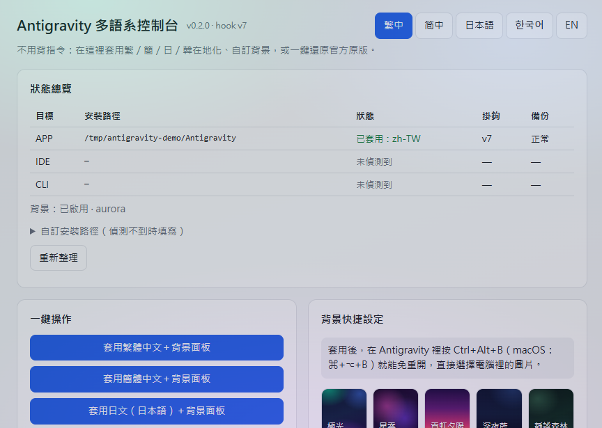
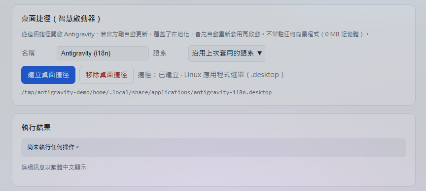
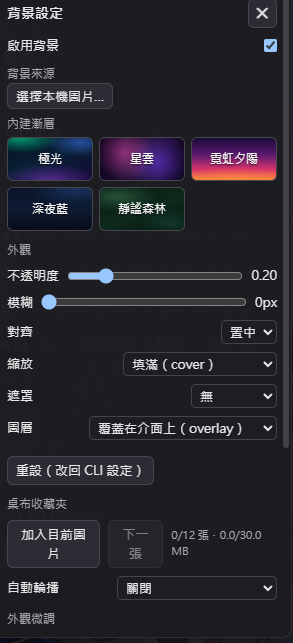
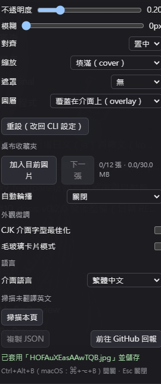

<p align="center"><a href="./README.md">繁體中文</a> | <a href="./README.zh-CN.md">简体中文</a> | <a href="./README.ja.md">日本語</a> | <a href="./README.ko.md">한국어</a> | <b>English</b></p>

# antigravity-i18n

[](https://github.com/Carinoasd/antigravity-i18n/actions/workflows/ci.yml)
[](./LICENSE)
[](https://nodejs.org/)

A cross-platform (Linux / macOS / Windows / WSL) **localization and appearance tool for Google Antigravity**: Traditional Chinese (`zh-TW`), Simplified Chinese (`zh-CN`), Japanese (`ja`), Korean (`ko`) and custom backgrounds — **no commands to memorize**, just open the control panel and click.

## 📸 Screenshots

| Local control panel (5 languages, status overview, one-click apply) | Desktop shortcut (smart launcher, 0 MB resident memory) |
| :---: | :---: |
|  |  |
| **`Ctrl + Alt + B` panel: background, gradients & wallpaper gallery** | **`Ctrl + Alt + B` panel: appearance tweaks, 5-language switcher & scanner** |
|  |  |

<!-- More full-window Antigravity screenshots: add docs/images/app-*.png and remove this comment (guide: docs/images/README.md)
| Antigravity in Japanese | Untranslated scan results |
| :---: | :---: |
|  |  |
-->

## 🚀 Getting started

### Option 1: download the single executable and double-click it (recommended)

**No Node.js, no commands.** Download the file for your system from [Releases](https://github.com/Carinoasd/antigravity-i18n/releases/latest):

| System | File |
| --- | --- |
| Windows (x64) | `antigravity-i18n-win-x64.exe` |
| macOS (Apple silicon) | `antigravity-i18n-macos-arm64` |
| Linux (x64) | `antigravity-i18n-linux-x64` |

Double-click it and your browser opens the local control panel.

- **Windows**: if SmartScreen shows "Windows protected your PC", click **More info → Run anyway**. The executable is not signed with a paid code-signing certificate, which is why this appears.
- **macOS**: the first time, right-click the file in Finder → **Open**, then confirm. If it is still blocked, go to System Settings → Privacy & Security and click **Open Anyway**. Browsers may drop the executable bit: run `chmod +x antigravity-i18n-macos-arm64` first.
- **Linux**: `chmod +x antigravity-i18n-linux-x64 && ./antigravity-i18n-linux-x64`
- If something fails at startup, the window shows the error and waits for Enter before closing, so you can copy it into a bug report.

**Verify the download (recommended)**: each Release includes `SHA256SUMS.txt`. Put it next to the executable:

```bash
# macOS
shasum -a 256 -c SHA256SUMS.txt --ignore-missing
# Linux
sha256sum -c SHA256SUMS.txt --ignore-missing
```

```powershell
# Windows (PowerShell): compare the hash with the matching line in SHA256SUMS.txt
Get-FileHash .\antigravity-i18n-win-x64.exe -Algorithm SHA256
```

> Releases are built automatically when the maintainer pushes a `v*` tag. If there is no Release yet, use option 2.

### Option 2: run with npx (developers / Node.js already installed)

Requires [Node.js 20+](https://nodejs.org/):

```bash
npx github:Carinoasd/antigravity-i18n
```

> ⚠️ The npm package named `antigravity-i18n` is **not this project** (it belongs to another author). Use the `github:` form above, or install from source as shown below.

### What the control panel does

- Apply Traditional Chinese / Simplified Chinese / Japanese / Korean + background panel in one click
- Keep the English UI and only add custom backgrounds plus the `Ctrl+Alt+B` panel
- Restore the official build losslessly in one click
- Apply one of 5 built-in gradients or choose an image from your computer, and tune opacity / blur / tint
- Create a desktop shortcut that re-applies the localization automatically after official auto-updates
- Install or remove the AI global language rule (zero-touch mode, all four languages)

> The control panel listens on `127.0.0.1` only and generates a new access token on every start, so no other computer or website can drive it. Click "Close control panel" or press `Ctrl+C` to stop it.

## ✨ Features

- 🖥️ Supports Antigravity **App** (desktop 2.0+, `app.asar`), **IDE** (editor and Agent panel) and **CLI** (`agy`)
- 🧩 **Two-layer App localization**: static translation of the main-process menus / tray / updater, plus a **runtime DOM overlay** that translates the dynamically loaded React UI
- 🔒 Every file is SHA-256 hashed and backed up with a manifest before patching — **lossless one-click restore**
- 🧪 `--dry-run` previews matches and coverage without touching any file
- 🎛️ **In-app panel** (`Ctrl + Alt + B`): backgrounds, wallpaper gallery and slideshow, appearance tweaks, instant five-language switching and an untranslated-text scanner — all without restarting
- 🚀 **Smart launcher and desktop shortcut**: survives official auto-updates without any resident process (0 MB)
- 🪶 **Zero-touch mode**: installs only a global rule so the AI replies in your language — no app files changed
- 🎨 **Background-only mode**: `--lang none` keeps the English UI and only adds the background and panel
- ✅ Built-in CI dictionary validator (four-language key parity, placeholders, protected terms, Traditional/Simplified usage)

> ⚠️ This is a community project and is not affiliated with Google. Patching application files carries risk: preview with `--dry-run` first and make sure `restore` works for you.

## 🎛️ The `Ctrl + Alt + B` panel

Inside Antigravity, press **`Ctrl + Alt + B`** (macOS **`Cmd + Option + B`**). On **Settings → Appearance** a small "🖼 Background" button also appears. Every change applies instantly.

> The panel itself speaks five languages too: it follows the language Antigravity is currently showing (and switches along with the language menu below), and in background-only mode it picks one from your system / browser language.

- **Background**: pick a PNG / JPEG / WebP / GIF from your computer (up to 10 MB) or one of 5 built-in gradients, then tune opacity, blur, alignment, scaling, tint and layer mode.
- **Wallpaper gallery and slideshow**: "Add current image"saves the background to a gallery; click a thumbnail to switch, ✕ to delete. To keep memory low, the gallery is capped at **10 MB per image, 12 images and 30 MB in total**, and only the current image stays in memory. The slideshow can be off, switch on every window launch, or run every 15 / 30 / 60 minutes; there is also a "Next"button.
- **Appearance tweaks** (both off by default):
  - **CJK UI font**: uses the `PingFang TC` / `Microsoft JhengHei UI` / `Noto Sans CJK TC` / `Hiragino Sans` / `Malgun Gothic` stack for the regular UI; code, editors, terminals and monospace classes keep their fonts.
  - **Glassmorphism cards**: dialogs, menus and cards get a translucent background with `backdrop-filter: blur(10px)`.
- **Instant language switching**: 繁體中文 / 简体中文 / 日本語 / 한국어 / English (original). `apply` bundles all four dictionaries in a compact shared-key format, so switching re-translates the page without a reload. Native menus and the tray keep the language chosen at `apply`.
- **Scan for untranslated text**: lists the English UI strings on the current page that the dictionary does not cover yet (code, editors, terminals, AI replies and form contents are skipped). "Copy JSON"produces `{ "Original Text": "" }`, and "Report on GitHub"opens the missing-translation issue form.

Panel settings live in the app's IndexedDB and take priority over the CLI `background.json`; "Reset"goes back to the CLI settings. The CLI equivalents:

```bash
antigravity-i18n bg presets                                    # aurora, nebula, sunset, midnight, forest
antigravity-i18n bg preset midnight --opacity 0.3 --tint "rgba(0,0,0,0.25)"
antigravity-i18n bg set ~/Pictures/wallpaper.jpg --opacity 0.2 --blur 4
```

The background layer is `pointer-events: none` and never blocks clicks. On **WSL**, settings are mirrored to the Windows home (`C:\Users\<you>\.antigravity-i18n`) so the Windows build of Antigravity can read them.

## 🔁 Surviving auto-updates: `launch` and `shortcut`

Antigravity's auto-updater replaces `app.asar`, which wipes the localization. `launch` checks once **at the moment you open Antigravity**, re-applies if needed, starts Antigravity and exits immediately — **nothing stays resident (0 MB)**.

```bash
antigravity-i18n shortcut install                       # create a desktop shortcut that runs launch
antigravity-i18n shortcut install --name "Antigravity (JA)" --lang ja
antigravity-i18n launch                                 # or run it directly
```

| Situation | What `launch` does |
| --- | --- |
| `app.asar` matches the last patch and the hook is current | Starts right away (hash cached by size and modification time, so the check takes milliseconds) |
| SHA-256 changed (official update), the hook is outdated, or `--lang` differs | Backs up the new original, re-applies, then starts |
| Antigravity is already running and the file is locked | Prints a hint, skips this re-apply and still starts |

| Platform | Shortcut |
| --- | --- |
| Windows | Desktop `.lnk` with the Antigravity icon, runs minimized (no console flash) |
| WSL | Windows desktop `.lnk` that runs `wsl.exe -d <distro> -- … launch` (when Antigravity is installed on the Windows side) |
| macOS | `~/Desktop/<name>.command` |
| Linux | `~/.local/share/applications/antigravity-i18n.desktop` |

The control panel has a "Desktop shortcut" card too. When running via `npx`, the shortcut points into npx's temporary cache; prefer the single executable or a global install.

## 🔒 Safe backup and restore

- Before writing, every original file is hashed (SHA-256), backed up and read back for verification; the manifest records both hashes.
- `--dry-run` never writes anything, not even the tool's data directory.
- `restore` verifies the backup and restores **byte-for-byte**; if a file changed after patching (for example an official update), it stops unless you pass `--force`.
- Re-applying always starts from the original file, never from already translated content. If a write fails midway, already written files are rolled back.

## Install from source

```bash
git clone https://github.com/Carinoasd/antigravity-i18n.git
cd antigravity-i18n
npm install        # builds automatically
npm link           # makes the antigravity-i18n command available
antigravity-i18n   # no arguments: opens the control panel
```

Without `npm link`, run `node dist/cli.js <command>` instead.

## Command-line quick start

```bash
antigravity-i18n status                          # detect installs and current state
antigravity-i18n apply --lang ja --dry-run       # preview, changes nothing
antigravity-i18n apply --lang ja                 # apply (quit Antigravity first)
antigravity-i18n apply --lang none --target app  # background + Ctrl+Alt+B panel only, English UI
antigravity-i18n restore                         # restore the official build
antigravity-i18n rules install --lang ko         # zero-touch: AI replies in Korean only
```

## Commands

| Command | Description |
| --- | --- |
| `antigravity-i18n` / `ui [--port <n>] [--no-open]` | Open the local control panel (`127.0.0.1` only). In CI or non-interactive shells, running without arguments prints `--help` instead. |
| `status` (alias `doctor`) | Detected App / IDE / CLI paths, localization state, hook version, backups, background and global rules |
| `apply --lang <zh-TW\|zh-CN\|ja\|ko\|none> [--target <app\|ide\|cli\|all>] [--path <dir>] [--dry-run] [--force] [--no-runtime]` | Back up and patch. Refuses to re-apply unless `--force` (which always re-translates from the original backup). `none` = background-only mode for `app`. |
| `restore [--target ...] [--path <dir>] [--force]` | Verify backup SHA-256 and restore byte-for-byte |
| `rules <install\|remove\|status> [--lang <zh-TW\|zh-CN\|ja\|ko>]` | Manage `~/.gemini/config/rules/language-<lang>.md` (`trigger: always_on`) |
| `bg set <image>` / `bg preset <name>` / `bg presets` / `bg on\|off\|clear\|status` | Custom background (`--opacity`, `--blur`, `--size`, `--position`, `--mode overlay\|underlay`, `--tint`) |
| `launch [--lang <lang>] [--path <dir>] [--no-reapply]` | Smart launcher: re-applies after official auto-updates, then starts Antigravity and exits immediately |
| `shortcut <install\|remove\|status> [--name <name>] [--lang ...] [--path <dir>] [--dir <dir>] [--force]` | Create / remove a desktop shortcut that runs `launch` |
| `validate` | Dictionary validator for CI (exit code 0 / 1) |

After upgrading this tool, open Antigravity once through `launch` (or the shortcut), or run `antigravity-i18n apply --target app --lang <lang> --force`, to update the App hook (`status` tells you when).

## Troubleshooting: `EBUSY` / `EPERM` / `EACCES`

These mean Antigravity is still running (locking `app.asar`) or the install needs elevated permissions. Both the CLI and the control panel print concrete steps:

1. Quit Antigravity completely — close every window **and** right-click the tray / menu-bar icon → Quit
2. On Windows, end any remaining Antigravity process in Task Manager; for `C:\Program Files` installs, run the terminal as Administrator
3. On Linux / macOS system locations, use `sudo` or point `--path` at an install you can write to
4. Retry — every apply / restore backs up first, so retrying is safe

On macOS, modifying the app invalidates its code signature; re-sign it with `codesign --force --deep --sign - "/Applications/Antigravity.app"` after applying.

## 🤝 Contributing translations

1. **Quickest**: in Antigravity press `Ctrl + Alt + B` → "Scan this page"→ "Copy JSON", then "Report on GitHub"and paste the JSON into the [missing-translation issue form](https://github.com/Carinoasd/antigravity-i18n/issues/new?template=missing-translation.yml).
2. **Pull request**: edit `locales/<lang>/<module>.json` and **add the same key to all four languages** (the key must match the English UI text exactly). Run `node dist/cli.js validate` and make sure it reports 0 errors.
3. Terminology rules and the PR checklist: [CONTRIBUTING.md](./CONTRIBUTING.md).

## More documentation

- The [Traditional Chinese README](./README.md) is the most detailed reference (detection paths, replacement rules, runtime overlay internals, data directory layout).
- Release notes: [CHANGELOG.md](./CHANGELOG.md). Rules for AI coding assistants: [AGENTS.md](./AGENTS.md).

## ☕ Support & Sponsor

This project is 100% free and open source under the MIT License. If it saves you time, starring the repo, contributing translations, or buying the maintainer a coffee all help keep it updated (see [SPONSOR.md](./SPONSOR.md)):

<details>
<summary>Show Alipay QR code</summary>

<p align="center">
  
</p>

</details>

## License

[MIT](./LICENSE)
