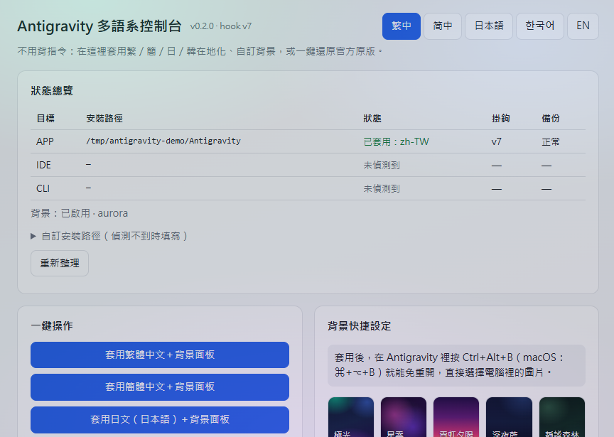
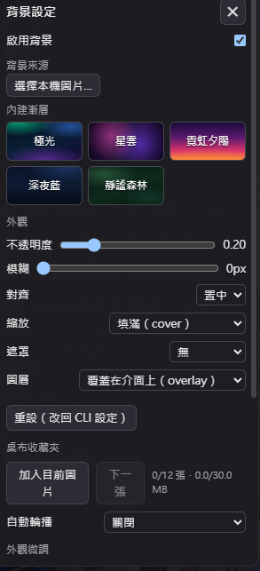
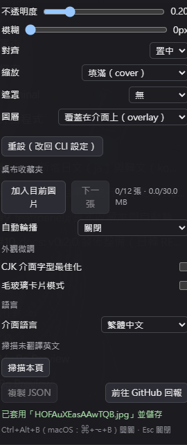
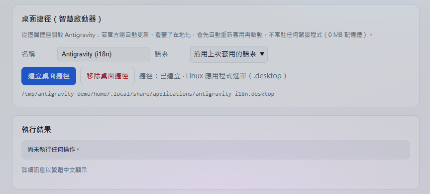

<p align="center"><a href="./README.md">繁體中文</a> | <a href="./README.zh-CN.md">简体中文</a> | <b>日本語</b> | <a href="./README.ko.md">한국어</a> | <a href="./README.en.md">English</a></p>

# antigravity-i18n

[](https://github.com/Carinoasd/antigravity-i18n/actions/workflows/ci.yml)
[](./LICENSE)
[](https://nodejs.org/)

**Google Antigravity を日本語で使うための、ローカライズ＆外観カスタマイズツール**です。Linux / macOS / Windows / WSL に対応し、日本語（`ja`）のほか繁体字中国語（`zh-TW`）、簡体字中国語（`zh-CN`）、韓国語（`ko`）を切り替えられます。背景画像の変更もできます。**コマンドを覚える必要はありません**。コントロールパネルを開いて、ボタンを押すだけです。

## 📸 スクリーンショット

> スクリーンショットは準備中です。メンテナー向けのファイル名の規則と個人情報のマスキング方法は [docs/images/README.md](./docs/images/README.md) をご覧ください。

<!-- スクリーンショット：docs/images/ に画像を置いたら、この行と表の下にあるコメント終了行を削除すると表示されます
| コントロールパネル | 日本語化した Antigravity |
| :---: | :---: |
|  |  |
| **Ctrl + Alt + B パネル：背景・壁紙コレクション・スライドショー** | **外観の微調整と表示言語の即時切り替え** |
|  |  |
| **未翻訳の英語をスキャン** | **デスクトップショートカット（スマートランチャー）** |
|  |  |
-->

## 🚀 はじめに

### 方法 1：単体の実行ファイルをダウンロードしてダブルクリック（おすすめ）

**Node.js のインストールもコマンド入力も不要です。** [Releases](https://github.com/Carinoasd/antigravity-i18n/releases/latest) からお使いの OS 向けのファイルをダウンロードしてください。

| OS | ファイル |
| --- | --- |
| Windows（x64） | `antigravity-i18n-win-x64.exe` |
| macOS（Apple シリコン） | `antigravity-i18n-macos-arm64` |
| Linux（x64） | `antigravity-i18n-linux-x64` |

ダブルクリックすると、ブラウザでローカルのコントロールパネルが開きます。

- **Windows**：「Windows によって PC が保護されました」（SmartScreen）と表示されたら、「**詳細情報** → **実行**」を選んでください。有料のコード署名証明書を使っていないため、この警告が表示されます。
- **macOS**：初回は Finder でファイルを**右クリック → 開く**を選び、確認画面で「開く」を押してください。それでもブロックされる場合は「システム設定 → プライバシーとセキュリティ」で「**このまま開く**」を押します。ブラウザでダウンロードすると実行権限が外れることがあるので、先に `chmod +x antigravity-i18n-macos-arm64` を実行してください。
- **Linux**：`chmod +x antigravity-i18n-linux-x64 && ./antigravity-i18n-linux-x64`
- 起動時にエラーが起きた場合は、エラーメッセージを表示したまま Enter キーを押すまでウィンドウが閉じないので、そのまま不具合報告に貼り付けられます。

**ダウンロードしたファイルの検証（推奨）**：各 Release には `SHA256SUMS.txt` が添付されています。実行ファイルと同じフォルダーに置いて、次のコマンドを実行します。

```bash
# macOS
shasum -a 256 -c SHA256SUMS.txt --ignore-missing
# Linux
sha256sum -c SHA256SUMS.txt --ignore-missing
```

```powershell
# Windows（PowerShell）：表示されたハッシュを SHA256SUMS.txt の該当行と見比べます
Get-FileHash .\antigravity-i18n-win-x64.exe -Algorithm SHA256
```

> Release はメンテナーが `v*` タグを push すると自動でビルドされます。まだ Release がない場合は方法 2 をお使いください。

### 方法 2：npx で実行（開発者・Node.js をインストール済みの方）

[Node.js 20 以上](https://nodejs.org/)が必要です。

```bash
npx github:Carinoasd/antigravity-i18n
```

> ⚠️ npm に公開されている `antigravity-i18n` という名前のパッケージは**本プロジェクトではありません**（別の作者のものです）。上記の `github:` 形式を使うか、後述の手順でソースからインストールしてください。

### コントロールパネルでできること

- 日本語・繁体字中国語・簡体字中国語・韓国語の適用（背景パネル付き）をワンクリックで
- 英語 UI のまま、背景と `Ctrl+Alt+B` パネルだけを追加
- 公式版へのワンクリック復元（完全に元どおり）
- 内蔵のグラデーション 5 種類、または PC 内の画像を背景に設定し、不透明度・ぼかし・ティントを調整
- デスクトップショートカットの作成：以後このショートカットから起動すれば、公式の自動アップデートで日本語化が消えても自動で再適用
- AI のグローバル言語ルールのインストール・削除（非侵入モード。4 言語に対応）

> コントロールパネルは `127.0.0.1` でのみ待ち受け、起動のたびに新しいアクセストークンを発行します。ほかの PC や Web サイトから操作されることはありません。「パネルを閉じる」ボタンか `Ctrl+C` で終了します。

## ✨ 主な機能

- 🖥️ Antigravity の **App**（デスクトップ版 2.0 以降、`app.asar`）、**IDE**（エディターと Agent パネル）、**CLI**（`agy`）に対応
- 🧩 App は**二層構成**で翻訳：メインプロセスのメニュー・システムトレイ・更新通知を静的に翻訳し、動的に読み込まれる React UI は**実行時 DOM 注入レイヤー**がリアルタイムに翻訳
- 🔒 書き換え前にすべてのファイルの SHA-256 を計算してバックアップし、マニフェストに記録。**ワンクリックで完全に元に戻せます**
- 🧪 `--dry-run` で一致件数とカバー率を事前に確認でき、ファイルには一切触れません
- 🎛️ **アプリ内パネル**（`Ctrl + Alt + B`）：背景、壁紙コレクションとスライドショー、外観の微調整、5 言語の即時切り替え、未翻訳スキャン。すべて再起動なしで反映
- 🚀 **スマートランチャーとデスクトップショートカット**：公式の自動アップデート後も日本語化を自動で復旧。常駐プロセスはなし（メモリ使用 0 MB）
- 🪶 **非侵入モード**：グローバルルールを追加するだけで AI が日本語で回答。アプリのファイルは一切変更しません
- 🎨 **背景のみモード**：`--lang none` で英語 UI のまま背景とパネルだけを追加
- ✅ CI 用の辞書検証ツールを内蔵（4 言語のキー一致、プレースホルダー、保護語、繁体字・簡体字の用語チェック）

> ⚠️ 本プロジェクトはコミュニティによる非公式ツールで、Google とは関係ありません。アプリのファイルを書き換えるため、まず `--dry-run` で確認し、`restore` で元に戻せることを確かめてからお使いください。

## 🎛️ `Ctrl + Alt + B` パネル

Antigravity の画面で **`Ctrl + Alt + B`**（macOS は **`Cmd + Option + B`**）を押すとパネルが開きます。「設定 → 外観（Appearance）」ページでは、右下に「🖼 背景の設定」ボタンも表示されます。変更はすべてその場で反映されます。

> パネル自体の表示も 5 言語に対応しています。Antigravity の表示言語に合わせて自動で切り替わり（下の「表示言語」で切り替えるとパネルも同時に切り替わります）、背景のみモードではシステム（ブラウザー）の言語設定から選ばれます。

- **背景**：PC 内の PNG / JPEG / WebP / GIF（10 MB まで）か、内蔵のグラデーション 5 種類から選び、不透明度・ぼかし・配置・拡大縮小・ティント・レイヤーの重ね方を調整できます。
- **壁紙コレクションとスライドショー**：「現在の画像を追加」で今の背景をコレクションに保存し、サムネイルをクリックすれば切り替え、✕ で削除できます。メモリを圧迫しないよう、**1 枚あたり 10 MB・最大 12 枚・合計 30 MB** が上限で、ふだんメモリに置くのは表示中の 1 枚だけです。スライドショーは「オフ」「ウィンドウを開くたびに次の画像」「15 分／30 分／60 分ごと」から選べ、「次へ」ボタンで手動で切り替えることもできます。
- **外観の微調整**（どちらも初期状態はオフ）：
  - **CJK UI フォントの最適化**：通常の UI に `PingFang TC`、`Microsoft JhengHei UI`、`Noto Sans CJK TC`、`Hiragino Sans`、`Malgun Gothic` のフォントスタックを適用します。コード、エディター、ターミナル、mono 系クラスの等幅フォントには影響しません。
  - **すりガラス風カード**：ダイアログ、メニュー、カードを半透明にし、`backdrop-filter: blur(10px)` をかけます。
- **表示言語の即時切り替え**：繁體中文／简体中文／日本語／한국어／English（原文）。`apply` 時に 4 言語の辞書をキー共有のコンパクトな形式でまとめて組み込むため、ページを再読み込みせずにその場で翻訳し直します。ネイティブメニューとシステムトレイは `apply` で指定した言語のままです。
- **未翻訳の英語をスキャン**：表示中のページから、まだ辞書に登録されていない英語の UI 文字列を一覧にします（コード、エディター、ターミナル、AI の回答、入力欄の内容は対象外）。「JSON をコピー」で `{ "Original Text": "" }` 形式に書き出し、「GitHub で報告」で報告フォームを開けます。

パネルの設定はアプリの IndexedDB に保存され、CLI の `background.json` より優先されます。「リセット」を押すと CLI の設定に戻ります。CLI での同等の操作は次のとおりです。

```bash
antigravity-i18n bg presets                                    # aurora、nebula、sunset、midnight、forest
antigravity-i18n bg preset midnight --opacity 0.3 --tint "rgba(0,0,0,0.25)"
antigravity-i18n bg set ~/Pictures/wallpaper.jpg --opacity 0.2 --blur 4
```

背景レイヤーは `pointer-events: none` なので、クリックの邪魔にはなりません。**WSL** では、Windows 版の Antigravity からも読めるよう、設定を Windows のホーム（`C:\Users\<ユーザー名>\.antigravity-i18n`）にも自動でミラーします。

## 🔁 自動アップデート対策：`launch` と `shortcut`

Antigravity は自動アップデートのたびに `app.asar` を丸ごと置き換えるため、そのままだと日本語化が消えてしまいます。`launch` は **Antigravity を起動するその瞬間**に一度だけ状態を確認し、必要なら自動で再適用してから Antigravity を起動し、すぐに終了します。**常駐するプロセスはありません（メモリ使用 0 MB）**。

```bash
antigravity-i18n shortcut install                          # launch を実行するデスクトップショートカットを作成
antigravity-i18n shortcut install --name "Antigravity 日本語" --lang ja
antigravity-i18n launch                                    # 直接実行することもできます
```

| 状況 | `launch` の動作 |
| --- | --- |
| `app.asar` が前回の適用時と同じで、フックも最新 | そのまま起動（ハッシュはファイルサイズと更新日時でキャッシュするため、確認は数ミリ秒） |
| SHA-256 が変わった（公式アップデート直後）、フックが古い、または `--lang` で別の言語を指定 | 新しい元ファイルをバックアップしてから再適用し、起動 |
| Antigravity が起動中でファイルがロックされている | メッセージを表示して今回の再適用だけをスキップし、通常どおり起動 |

| OS | ショートカット |
| --- | --- |
| Windows | デスクトップの `.lnk`（Antigravity のアイコン付き。最小化で実行するので黒いウィンドウがちらつきません） |
| WSL | Windows 側に Antigravity がある場合、Windows のデスクトップに `.lnk` を作成し、`wsl.exe -d <ディストリビューション> -- … launch` で実行 |
| macOS | `~/Desktop/<名前>.command` |
| Linux | `~/.local/share/applications/antigravity-i18n.desktop` |

コントロールパネルの「デスクトップショートカット」からも作成できます。`npx` で実行している場合、ショートカットは npx の一時キャッシュを指すため、キャッシュが消えると使えなくなります。単体の実行ファイルかグローバルインストールでの利用をおすすめします。

## 🔒 安全なバックアップと復元

- 書き込む前に、元ファイルごとに SHA-256 を計算してバックアップし、読み戻して検証します。マニフェストには適用前後の両方のハッシュを記録します。
- `--dry-run` はツールのデータフォルダーも含めて、何も書き込みません。
- `restore` はバックアップを検証したうえで**1 バイト単位で完全に**元に戻します。適用後にファイルが変更されていた場合（公式アップデートなど）は、新しい版を古い版で上書きしないよう中止します。それでも戻す場合は `--force` を付けてください。
- 再適用は必ず元のファイルから行うため、翻訳済みの内容を二重に翻訳することはありません。書き込みの途中で失敗した場合は、書き込み済みのファイルを自動でロールバックします。

## ソースからインストール

```bash
git clone https://github.com/Carinoasd/antigravity-i18n.git
cd antigravity-i18n
npm install        # 自動でビルドされます
npm link           # antigravity-i18n コマンドが使えるようになります
antigravity-i18n   # 引数なしで実行するとコントロールパネルが開きます
```

`npm link` を使わない場合は、`node dist/cli.js <コマンド>` で実行できます。

## コマンドラインでのクイックスタート

```bash
antigravity-i18n status                          # インストール先と現在の状態を確認
antigravity-i18n apply --lang ja --dry-run       # プレビュー（ファイルは変更しません）
antigravity-i18n apply --lang ja                 # 適用（先に Antigravity を終了してください）
antigravity-i18n apply --lang none --target app  # 英語 UI のまま背景と Ctrl+Alt+B パネルだけを追加
antigravity-i18n restore                         # 公式版に戻す
antigravity-i18n rules install --lang ja         # 非侵入モード：AI の回答だけを日本語に
```

## コマンド一覧

| コマンド | 説明 |
| --- | --- |
| `antigravity-i18n` / `ui [--port <n>] [--no-open]` | ローカルのコントロールパネルを開きます（`127.0.0.1` のみ）。CI や非対話環境で引数なしで実行した場合は、代わりに `--help` を表示します。 |
| `status`（別名 `doctor`） | 検出した App / IDE / CLI のパス、ローカライズの状態、フックのバージョン、バックアップ、背景、グローバルルール |
| `apply --lang <zh-TW\|zh-CN\|ja\|ko\|none> [--target <app\|ide\|cli\|all>] [--path <フォルダー>] [--dry-run] [--force] [--no-runtime]` | バックアップしてから書き換えます。適用済みの場合は `--force` がない限り上書きしません（`--force` は必ず元のバックアップから翻訳し直します）。`none` は `app` 専用の背景のみモードです。 |
| `restore [--target ...] [--path <フォルダー>] [--force]` | バックアップの SHA-256 を検証し、1 バイト単位で元に戻します |
| `rules <install\|remove\|status> [--lang <zh-TW\|zh-CN\|ja\|ko>]` | `~/.gemini/config/rules/language-<言語>.md`（`trigger: always_on`）を管理します |
| `bg set <画像>` / `bg preset <名前>` / `bg presets` / `bg on\|off\|clear\|status` | 背景のカスタマイズ（`--opacity`、`--blur`、`--size`、`--position`、`--mode overlay\|underlay`、`--tint`） |
| `launch [--lang <言語>] [--path <フォルダー>] [--no-reapply]` | スマートランチャー：公式アップデート後なら再適用してから Antigravity を起動し、すぐに終了します |
| `shortcut <install\|remove\|status> [--name <名前>] [--lang ...] [--path <フォルダー>] [--dir <フォルダー>] [--force]` | `launch` を実行するデスクトップショートカットを作成・削除します |
| `validate` | CI 用の辞書検証（終了コード 0 / 1） |

本ツールを更新したら、`launch`（またはショートカット）から一度 Antigravity を起動するか、`antigravity-i18n apply --target app --lang ja --force` を実行して App のフックを更新してください（必要なときは `status` が知らせてくれます）。

## トラブルシューティング：`EBUSY` / `EPERM` / `EACCES`

Antigravity がまだ動いていて `app.asar` がロックされているか、インストール先に管理者権限が必要なことを示しています。CLI とコントロールパネルのどちらでも、具体的な対処手順を表示します。

1. Antigravity を完全に終了します。すべてのウィンドウを閉じ、**さらに**システムトレイ（メニューバー）のアイコンを右クリック → Quit（終了）
2. Windows の場合は、タスクマネージャーで残っている Antigravity のプロセスを終了します。`C:\Program Files` にインストールしている場合は、ターミナルを管理者として実行してください
3. Linux / macOS のシステムフォルダーにある場合は `sudo` を使うか、`--path` で書き込み可能なインストール先を指定します
4. もう一度実行します。適用も復元も必ず先にバックアップを取るので、やり直しても安全です

macOS ではアプリの中身を変更するとコード署名が無効になります。適用後に `codesign --force --deep --sign - "/Applications/Antigravity.app"` で署名し直してください。

## 🤝 翻訳への協力

翻訳されていない文字列や、不自然な訳を見つけたらぜひ教えてください。

1. **いちばん手軽な方法**：Antigravity で `Ctrl + Alt + B` → 「このページをスキャン」→ 「JSON をコピー」の順に押し、「GitHub で報告」から開く[未翻訳報告フォーム](https://github.com/Carinoasd/antigravity-i18n/issues/new?template=missing-translation.yml)に JSON を貼り付けてください。
2. **Pull Request を送る**：`locales/<言語>/<モジュール>.json` を編集し、**4 言語すべてに同じキーを追加**します（キーは画面に表示される英語と完全に一致させてください）。`node dist/cli.js validate` を実行し、エラーが 0 件であることを確認してから送ってください。
3. 用語のルールと PR のチェックリストは [CONTRIBUTING.md](./CONTRIBUTING.md) にまとめています。

## そのほかのドキュメント

- [繁体字中国語の README](./README.md) が最も詳しいリファレンスです（検出するパス、置換ルール、実行時注入レイヤーの仕組み、データフォルダーの構成）。
- 変更履歴は [CHANGELOG.md](./CHANGELOG.md)、AI コーディングアシスタント向けの開発ルールは [AGENTS.md](./AGENTS.md) をご覧ください。

## ライセンス

[MIT](./LICENSE)
