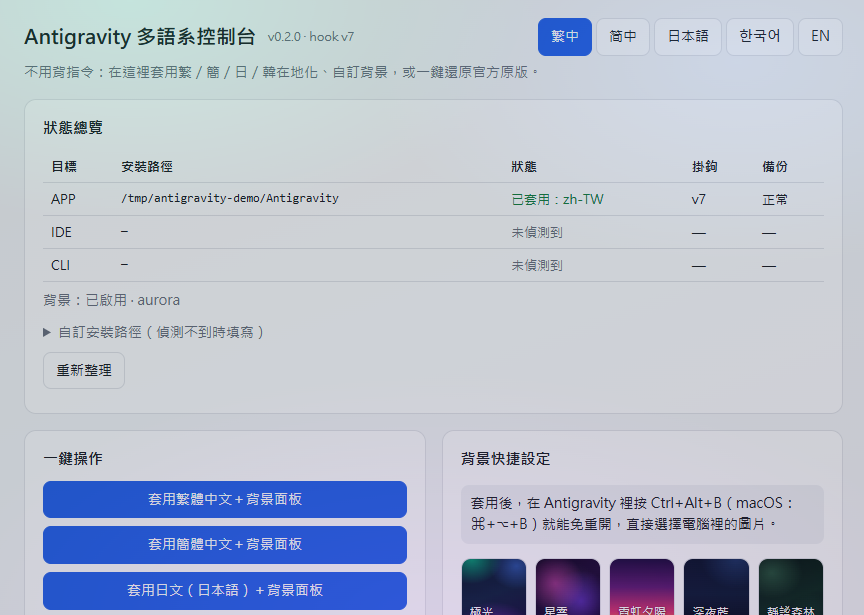
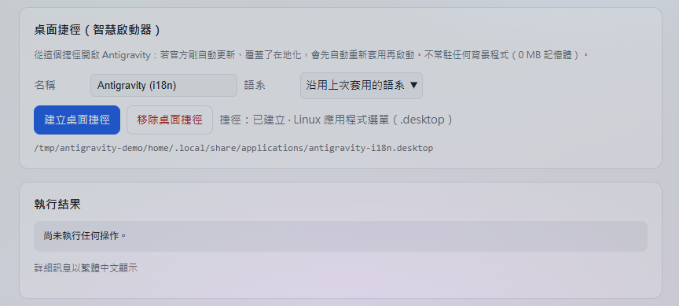
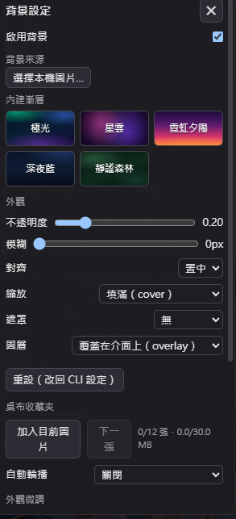
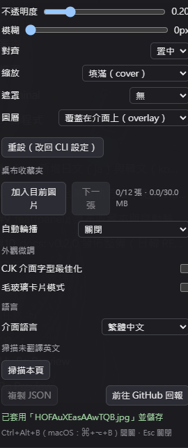

<p align="center"><a href="./README.md">繁體中文</a> | <a href="./README.zh-CN.md">简体中文</a> | <a href="./README.ja.md">日本語</a> | <b>한국어</b> | <a href="./README.en.md">English</a></p>

# antigravity-i18n

[](https://github.com/Carinoasd/antigravity-i18n/actions/workflows/ci.yml)
[](./LICENSE)
[](https://nodejs.org/)

**Google Antigravity를 한국어로 쓰기 위한 현지화·외관 꾸미기 도구**입니다. Linux / macOS / Windows / WSL을 지원하며, 한국어(`ko`)뿐 아니라 번체 중국어(`zh-TW`), 간체 중국어(`zh-CN`), 일본어(`ja`)로도 바꿀 수 있고 배경 이미지도 직접 꾸밀 수 있습니다. **명령어를 외울 필요 없이** 제어판을 열고 버튼만 누르면 됩니다.

## 📸 스크린샷

| 로컬 제어판 (5개 언어 전환 · 상태 요약 · 원클릭 적용) | 바탕 화면 바로 가기 (스마트 런처 · 메모리 0 MB 상주 없음) |
| :---: | :---: |
|  |  |
| **`Ctrl + Alt + B` 패널: 배경 · 그라데이션 · 컬렉션 슬라이드쇼** | **`Ctrl + Alt + B` 패널: 외관 미세 조정 · 5개 언어 전환 · 미번역 검사** |
|  |  |

<!-- 추가 앱 화면 스크린샷: docs/images/에 추가한 뒤 이 주석을 지우면 표시됩니다 (규칙: docs/images/README.md)
| 한국어로 바꾼 Antigravity | 미번역 검사 결과 |
| :---: | :---: |
|  |  |
-->

## 🚀 시작하기

### 방법 1: 단일 실행 파일을 내려받아 더블 클릭 (추천)

**Node.js 설치도, 명령어 입력도 필요 없습니다.** [Releases](https://github.com/Carinoasd/antigravity-i18n/releases/latest)에서 사용하는 운영체제에 맞는 파일을 내려받으세요.

| 운영체제 | 파일 |
| --- | --- |
| Windows (x64) | `antigravity-i18n-win-x64.exe` |
| macOS (Apple 실리콘) | `antigravity-i18n-macos-arm64` |
| Linux (x64) | `antigravity-i18n-linux-x64` |

더블 클릭하면 브라우저에서 로컬 제어판이 열립니다.

- **Windows**: "Windows의 PC 보호"(SmartScreen) 창이 뜨면 **추가 정보 → 실행**을 누르세요. 유료 코드 서명 인증서를 사용하지 않아서 표시되는 경고입니다.
- **macOS**: 처음 실행할 때는 Finder에서 파일을 **우클릭 → 열기**를 선택한 뒤 확인 창에서 "열기"를 누르세요. 그래도 막히면 "시스템 설정 → 개인정보 보호 및 보안"에서 **그래도 열기**를 누르면 됩니다. 브라우저로 내려받으면 실행 권한이 빠질 수 있으니 먼저 `chmod +x antigravity-i18n-macos-arm64`를 실행하세요.
- **Linux**: `chmod +x antigravity-i18n-linux-x64 && ./antigravity-i18n-linux-x64`
- 실행 중 오류가 나면 오류 메시지를 띄운 채 Enter 키를 누를 때까지 창이 닫히지 않으므로, 그대로 복사해 버그 신고에 붙여 넣을 수 있습니다.

**내려받은 파일 검증 (권장)**: 각 Release에는 `SHA256SUMS.txt`가 함께 올라갑니다. 실행 파일과 같은 폴더에 두고 다음 명령을 실행하세요.

```bash
# macOS
shasum -a 256 -c SHA256SUMS.txt --ignore-missing
# Linux
sha256sum -c SHA256SUMS.txt --ignore-missing
```

```powershell
# Windows (PowerShell): 출력된 해시를 SHA256SUMS.txt의 해당 줄과 비교하세요
Get-FileHash .\antigravity-i18n-win-x64.exe -Algorithm SHA256
```

> Release는 관리자가 `v*` 태그를 push하면 자동으로 빌드됩니다. 아직 Release가 없다면 방법 2를 이용하세요.

### 방법 2: npx로 실행 (개발자 / Node.js가 이미 설치된 경우)

[Node.js 20 이상](https://nodejs.org/)이 필요합니다.

```bash
npx github:Carinoasd/antigravity-i18n
```

> ⚠️ npm에 올라와 있는 `antigravity-i18n`이라는 이름의 패키지는 **이 프로젝트가 아닙니다**(다른 작성자의 패키지입니다). 위의 `github:` 형식을 쓰거나 아래 안내대로 소스에서 설치하세요.

### 제어판에서 할 수 있는 일

- 한국어·번체 중국어·간체 중국어·일본어를 배경 패널과 함께 원클릭으로 적용
- 영어 UI는 그대로 두고 배경과 `Ctrl+Alt+B` 패널만 추가
- 공식 버전으로 원클릭 복원 (완전히 원래대로)
- 내장 그라데이션 5종이나 PC에 있는 이미지를 배경으로 지정하고 불투명도·흐림·틴트 조절
- 바탕 화면 바로 가기 만들기: 이후 이 바로 가기로 실행하면 공식 자동 업데이트로 한국어가 사라져도 자동으로 다시 적용
- AI 전역 언어 규칙 설치·삭제 (무침투 모드, 4개 언어 지원)

> 제어판은 `127.0.0.1`에서만 동작하고 실행할 때마다 새 접근 토큰을 발급하므로, 다른 PC나 웹사이트에서 조작할 수 없습니다. "제어판 닫기" 버튼이나 `Ctrl+C`로 종료합니다.

## ✨ 주요 기능

- 🖥️ Antigravity **App**(데스크톱 2.0 이상, `app.asar`), **IDE**(편집기와 Agent 패널), **CLI**(`agy`) 지원
- 🧩 App은 **2계층 방식**으로 번역: 메인 프로세스의 메뉴·시스템 트레이·업데이트 알림은 정적으로 번역하고, 동적으로 불러오는 React UI는 **런타임 DOM 주입 계층**이 실시간으로 번역
- 🔒 수정 전에 모든 파일의 SHA-256을 계산해 백업하고 매니페스트에 기록하므로 **원클릭으로 완벽하게 복원**할 수 있습니다
- 🧪 `--dry-run`으로 일치 건수와 적용률을 미리 확인할 수 있고, 파일은 전혀 건드리지 않습니다
- 🎛️ **앱 내 패널**(`Ctrl + Alt + B`): 배경, 배경화면 컬렉션과 슬라이드쇼, 외관 미세 조정, 5개 언어 즉시 전환, 미번역 검사까지 모두 재시작 없이 반영
- 🚀 **스마트 런처와 바탕 화면 바로 가기**: 공식 자동 업데이트 뒤에도 한국어를 자동으로 복구하며, 상주 프로세스는 없습니다(메모리 0 MB)
- 🪶 **무침투 모드**: 전역 규칙만 추가해 AI가 한국어로 답하도록 하며, 앱 파일은 전혀 수정하지 않습니다
- 🎨 **배경 전용 모드**: `--lang none`으로 영어 UI를 유지한 채 배경과 패널만 추가
- ✅ CI용 사전 검증 도구 내장 (4개 언어 키 일치, 자리표시자, 보호 용어, 번체·간체 용어 검사)

> ⚠️ 이 프로젝트는 커뮤니티에서 만든 비공식 도구이며 Google과는 관련이 없습니다. 앱 파일을 수정하므로 먼저 `--dry-run`으로 확인하고, `restore`로 원래대로 되돌릴 수 있는지 확인한 뒤 사용하세요.

## 🎛️ `Ctrl + Alt + B` 패널

Antigravity 화면에서 **`Ctrl + Alt + B`**(macOS는 **`Cmd + Option + B`**)를 누르면 패널이 열립니다. "설정 → 모양(Appearance)" 페이지에서는 오른쪽 아래에 "🖼 배경 설정" 버튼도 나타납니다. 모든 변경 사항은 바로 반영됩니다.

> 패널 자체도 5개 언어를 지원합니다. Antigravity의 표시 언어에 맞춰 자동으로 바뀌며(아래의 "표시 언어"로 바꾸면 패널도 함께 바뀝니다), 배경 전용 모드에서는 시스템(브라우저) 언어 설정에 따라 정해집니다.

- **배경**: PC에 있는 PNG / JPEG / WebP / GIF(최대 10 MB)나 내장 그라데이션 5종 중에서 고른 뒤, 불투명도·흐림·정렬·크기·틴트·레이어 방식을 조절할 수 있습니다.
- **배경화면 컬렉션과 슬라이드쇼**: "현재 이미지 추가"로 지금 배경을 컬렉션에 저장하고, 썸네일을 누르면 바로 바뀌며 ✕로 삭제할 수 있습니다. 메모리 부담을 줄이기 위해 **이미지 1장당 10 MB, 최대 12장, 합계 30 MB**로 제한하며, 평소에는 지금 보이는 1장만 메모리에 둡니다. 슬라이드쇼는 "끄기", "창을 열 때마다 다음 이미지", "15분/30분/60분마다" 중에서 고를 수 있고, "다음" 버튼으로 직접 넘길 수도 있습니다.
- **외관 미세 조정** (둘 다 기본값은 꺼짐):
  - **CJK UI 글꼴 최적화**: 일반 UI에 `PingFang TC`, `Microsoft JhengHei UI`, `Noto Sans CJK TC`, `Hiragino Sans`, `Malgun Gothic` 글꼴 스택을 적용합니다. 코드, 편집기, 터미널, mono 계열 클래스의 고정폭 글꼴에는 영향을 주지 않습니다.
  - **반투명 유리 카드**: 대화 상자, 메뉴, 카드에 반투명 배경과 `backdrop-filter: blur(10px)`를 적용합니다.
- **표시 언어 즉시 전환**: 繁體中文 / 简体中文 / 日本語 / 한국어 / English(원문). `apply` 때 4개 언어 사전을 키를 공유하는 압축 형식으로 함께 넣어 두기 때문에, 페이지를 새로 고치지 않고 그 자리에서 다시 번역합니다. 기본 메뉴와 시스템 트레이는 `apply`에서 지정한 언어를 유지합니다.
- **번역되지 않은 영어 검사**: 지금 보고 있는 페이지에서 아직 사전에 없는 영어 UI 문자열을 목록으로 보여 줍니다(코드, 편집기, 터미널, AI 답변, 입력란 내용은 제외). "JSON 복사"로 `{ "Original Text": "" }` 형식으로 내보내고, "GitHub에 신고"로 신고 양식을 열 수 있습니다.

패널 설정은 앱의 IndexedDB에 저장되며 CLI의 `background.json`보다 우선합니다. "초기화"를 누르면 CLI 설정으로 돌아갑니다. CLI에서는 다음과 같이 같은 작업을 할 수 있습니다.

```bash
antigravity-i18n bg presets                                    # aurora, nebula, sunset, midnight, forest
antigravity-i18n bg preset midnight --opacity 0.3 --tint "rgba(0,0,0,0.25)"
antigravity-i18n bg set ~/Pictures/wallpaper.jpg --opacity 0.2 --blur 4
```

배경 레이어는 `pointer-events: none`이라 클릭을 방해하지 않습니다. **WSL**에서는 Windows용 Antigravity도 읽을 수 있도록 설정을 Windows 홈 폴더(`C:\Users\<사용자>\.antigravity-i18n`)에도 자동으로 복사합니다.

## 🔁 자동 업데이트 대비: `launch`와 `shortcut`

Antigravity는 자동 업데이트할 때마다 `app.asar`를 통째로 교체하기 때문에, 그대로 두면 한국어 현지화가 사라집니다. `launch`는 **Antigravity를 실행하는 바로 그 순간**에 한 번만 상태를 확인해 필요하면 자동으로 다시 적용하고, Antigravity를 실행한 뒤 곧바로 종료합니다. **상주하는 프로세스는 없습니다(메모리 0 MB)**.

```bash
antigravity-i18n shortcut install                          # launch를 실행하는 바탕 화면 바로 가기 만들기
antigravity-i18n shortcut install --name "Antigravity 한국어" --lang ko
antigravity-i18n launch                                    # 직접 실행해도 됩니다
```

| 상황 | `launch`의 동작 |
| --- | --- |
| `app.asar`가 지난번 적용 때와 같고 후크도 최신 | 바로 실행 (해시를 파일 크기와 수정 시각으로 캐시하므로 확인은 몇 밀리초) |
| SHA-256이 바뀜(공식 업데이트 직후), 후크가 오래됨, 또는 `--lang`으로 다른 언어를 지정 | 새 원본 파일을 백업한 뒤 다시 적용하고 실행 |
| Antigravity가 이미 실행 중이라 파일이 잠겨 있음 | 안내 메시지를 표시하고 이번 재적용만 건너뛴 뒤 그대로 실행 |

| 운영체제 | 바로 가기 |
| --- | --- |
| Windows | 바탕 화면 `.lnk` (Antigravity 아이콘 사용, 최소화 상태로 실행해 검은 창이 깜박이지 않음) |
| WSL | Windows 쪽에 Antigravity가 설치되어 있으면 Windows 바탕 화면에 `.lnk`를 만들고 `wsl.exe -d <배포판> -- … launch`로 실행 |
| macOS | `~/Desktop/<이름>.command` |
| Linux | `~/.local/share/applications/antigravity-i18n.desktop` |

제어판의 "바탕 화면 바로 가기" 영역에서도 만들 수 있습니다. `npx`로 실행 중이라면 바로 가기가 npx의 임시 캐시를 가리키므로 캐시가 지워지면 쓸 수 없게 됩니다. 단일 실행 파일이나 전역 설치를 권장합니다.

## 🔒 안전한 백업과 복원

- 쓰기 전에 원본 파일마다 SHA-256을 계산해 백업하고, 다시 읽어 검증합니다. 매니페스트에는 적용 전후의 해시를 모두 기록합니다.
- `--dry-run`은 도구의 데이터 폴더를 포함해 아무것도 쓰지 않습니다.
- `restore`는 백업을 검증한 뒤 **바이트 단위로 완벽하게** 되돌립니다. 적용 후 파일이 바뀌었다면(공식 업데이트 등) 새 버전을 옛 버전으로 덮어쓰지 않도록 중단하며, 그래도 되돌리려면 `--force`를 붙이세요.
- 재적용은 항상 원본 파일에서 시작하므로 이미 번역된 내용을 다시 번역하지 않습니다. 쓰는 도중 실패하면 이미 쓴 파일을 자동으로 롤백합니다.

## 소스에서 설치

```bash
git clone https://github.com/Carinoasd/antigravity-i18n.git
cd antigravity-i18n
npm install        # 자동으로 빌드됩니다
npm link           # antigravity-i18n 명령을 바로 쓸 수 있게 됩니다
antigravity-i18n   # 인수 없이 실행하면 제어판이 열립니다
```

`npm link`를 쓰지 않는다면 `node dist/cli.js <명령>`으로 실행하세요.

## 명령줄 빠른 시작

```bash
antigravity-i18n status                          # 설치 위치와 현재 상태 확인
antigravity-i18n apply --lang ko --dry-run       # 미리 보기 (파일은 바꾸지 않음)
antigravity-i18n apply --lang ko                 # 적용 (먼저 Antigravity를 종료하세요)
antigravity-i18n apply --lang none --target app  # 영어 UI를 유지하고 배경과 Ctrl+Alt+B 패널만 추가
antigravity-i18n restore                         # 공식 버전으로 복원
antigravity-i18n rules install --lang ko         # 무침투 모드: AI 답변만 한국어로
```

## 명령 목록

| 명령 | 설명 |
| --- | --- |
| `antigravity-i18n` / `ui [--port <n>] [--no-open]` | 로컬 제어판을 엽니다(`127.0.0.1` 전용). CI나 비대화형 환경에서 인수 없이 실행하면 대신 `--help`를 표시합니다. |
| `status` (별칭 `doctor`) | 감지한 App / IDE / CLI 경로, 현지화 상태, 후크 버전, 백업, 배경, 전역 규칙 |
| `apply --lang <zh-TW\|zh-CN\|ja\|ko\|none> [--target <app\|ide\|cli\|all>] [--path <폴더>] [--dry-run] [--force] [--no-runtime]` | 백업한 뒤 수정합니다. 이미 적용했다면 `--force` 없이는 덮어쓰지 않습니다(`--force`는 항상 원본 백업에서 다시 번역합니다). `none`은 `app` 전용 배경 모드입니다. |
| `restore [--target ...] [--path <폴더>] [--force]` | 백업의 SHA-256을 검증하고 바이트 단위로 복원합니다 |
| `rules <install\|remove\|status> [--lang <zh-TW\|zh-CN\|ja\|ko>]` | `~/.gemini/config/rules/language-<언어>.md`(`trigger: always_on`)를 관리합니다 |
| `bg set <이미지>` / `bg preset <이름>` / `bg presets` / `bg on\|off\|clear\|status` | 배경 꾸미기(`--opacity`, `--blur`, `--size`, `--position`, `--mode overlay\|underlay`, `--tint`) |
| `launch [--lang <언어>] [--path <폴더>] [--no-reapply]` | 스마트 런처: 공식 업데이트 뒤라면 다시 적용한 다음 Antigravity를 실행하고 곧바로 종료합니다 |
| `shortcut <install\|remove\|status> [--name <이름>] [--lang ...] [--path <폴더>] [--dir <폴더>] [--force]` | `launch`를 실행하는 바탕 화면 바로 가기를 만들거나 삭제합니다 |
| `validate` | CI용 사전 검증 (종료 코드 0 / 1) |

이 도구를 업데이트한 뒤에는 `launch`(또는 바로 가기)로 Antigravity를 한 번 실행하거나 `antigravity-i18n apply --target app --lang ko --force`를 실행해 App 후크를 갱신하세요(필요할 때는 `status`가 알려 줍니다).

## 문제 해결: `EBUSY` / `EPERM` / `EACCES`

Antigravity가 아직 실행 중이라 `app.asar`가 잠겨 있거나, 설치 위치에 관리자 권한이 필요하다는 뜻입니다. CLI와 제어판 모두 구체적인 해결 방법을 보여 줍니다.

1. Antigravity를 완전히 종료합니다. 모든 창을 닫고, **추가로** 시스템 트레이(메뉴 막대)의 아이콘을 우클릭 → Quit(종료)
2. Windows에서는 작업 관리자에서 남아 있는 Antigravity 프로세스를 종료합니다. `C:\Program Files`에 설치했다면 터미널을 관리자 권한으로 실행하세요
3. Linux / macOS의 시스템 폴더에 설치했다면 `sudo`를 쓰거나 `--path`로 쓰기 권한이 있는 설치 위치를 지정하세요
4. 다시 시도합니다. 적용과 복원은 항상 먼저 백업하므로 다시 시도해도 안전합니다

macOS에서는 앱 내용을 수정하면 코드 서명이 무효가 됩니다. 적용한 뒤 `codesign --force --deep --sign - "/Applications/Antigravity.app"`으로 다시 서명하세요.

## 🤝 번역에 참여하기

번역되지 않았거나 어색한 문구를 발견하면 알려 주세요.

1. **가장 간단한 방법**: Antigravity에서 `Ctrl + Alt + B` → "이 페이지 검사" → "JSON 복사"를 차례로 누른 뒤, "GitHub에 신고"로 열리는 [미번역 신고 양식](https://github.com/Carinoasd/antigravity-i18n/issues/new?template=missing-translation.yml)에 JSON을 붙여 넣으세요.
2. **Pull Request 보내기**: `locales/<언어>/<모듈>.json`을 수정하고 **4개 언어 모두에 같은 키를 추가**하세요(키는 화면에 표시되는 영어와 정확히 같아야 합니다). `node dist/cli.js validate`를 실행해 오류가 0건인지 확인한 뒤 보내 주세요.
3. 용어 규칙과 PR 체크리스트는 [CONTRIBUTING.md](./CONTRIBUTING.md)에 정리되어 있습니다.

## 더 알아보기

- [번체 중국어 README](./README.md)가 가장 자세한 참고 문서입니다(감지 경로, 치환 규칙, 런타임 주입 계층의 동작 방식, 데이터 폴더 구조).
- 변경 내역은 [CHANGELOG.md](./CHANGELOG.md), AI 코딩 도우미를 위한 개발 규칙은 [AGENTS.md](./AGENTS.md)를 참고하세요.

## ☕ 후원하기

이 프로젝트는 MIT 라이선스의 무료 오픈소스입니다. 도움이 되셨다면 ⭐ Star나 번역 기여, 또는 커피 한 잔의 후원으로 응원해 주세요(자세한 내용은 [SPONSOR.md](./SPONSOR.md)):

<details>
<summary>Alipay(알리페이) QR 코드 보기</summary>

<p align="center">
  
</p>

</details>

## 라이선스

[MIT](./LICENSE)
