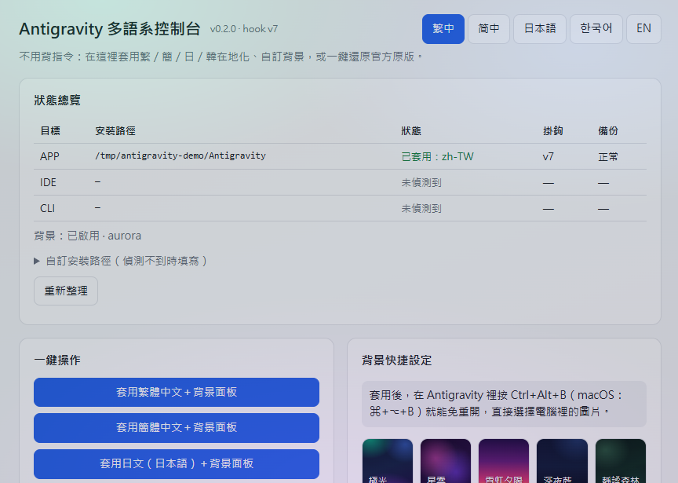
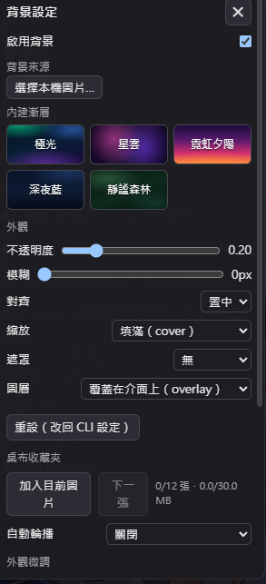
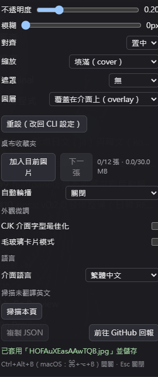
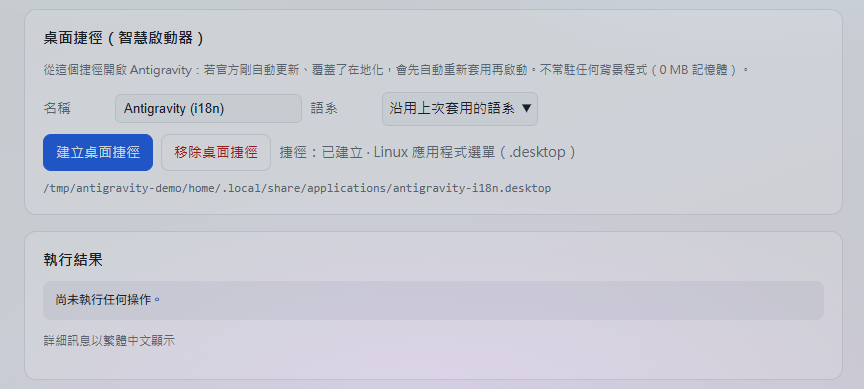

<p align="center"><b>繁體中文</b> | <a href="./README.zh-CN.md">简体中文</a> | <a href="./README.ja.md">日本語</a> | <a href="./README.ko.md">한국어</a> | <a href="./README.en.md">English</a></p>

# antigravity-i18n

[](https://github.com/Carinoasd/antigravity-i18n/actions/workflows/ci.yml)
[](./LICENSE)
[](https://nodejs.org/)

跨平台（Linux / macOS / Windows / WSL）的 **Google Antigravity 多語系在地化與外觀工具**：支援繁體中文（`zh-TW`）、簡體中文（`zh-CN`）、日文（`ja`）、韓文（`ko`）與自訂背景，**不用背指令**，打開圖形控制台按一下就好。

## 📸 實機展示

> 實機截圖整理中。維護者補圖的檔名約定與個資遮蓋規範請見 [docs/images/README.md](./docs/images/README.md)。

<!-- 實機展示截圖：把圖片放進 docs/images/ 後，刪除這一行與表格下方的註解結束行即可顯示
| 圖形控制台 | 套用繁體中文後的 Antigravity |
| :---: | :---: |
|  |  |
| **Ctrl + Alt + B 面板：背景、桌布收藏夾與輪播** | **外觀微調與五語即時切換** |
|  |  |
| **掃描本頁未翻譯英文** | **桌面捷徑（智慧啟動器）** |
|  |  |
-->

## 🚀 開始使用

### 方法一：下載單檔執行檔，雙擊開啟（推薦一般使用者）

**免裝 Node.js、免打指令。** 到 [Releases](https://github.com/Carinoasd/antigravity-i18n/releases/latest) 下載對應的檔案：

| 系統 | 檔案 |
| --- | --- |
| Windows（x64） | `antigravity-i18n-win-x64.exe` |
| macOS（Apple 晶片） | `antigravity-i18n-macos-arm64` |
| Linux（x64） | `antigravity-i18n-linux-x64` |

雙擊開啟後，瀏覽器會自動打開本機圖形控制台。

- **Windows**：出現「Windows 已保護您的電腦」（SmartScreen）時，按「**其他資訊** → **仍要執行**」。執行檔沒有付費的程式碼簽章，所以會出現這個提示。
- **macOS**：第一次請在 Finder 對檔案按**右鍵 → 打開**，再按「打開」；若仍被擋下，到「系統設定 → 隱私權與安全性」按「**強制打開**」。從瀏覽器下載的檔案可能失去執行權限，可先執行 `chmod +x antigravity-i18n-macos-arm64`。
- **Linux**：`chmod +x antigravity-i18n-linux-x64 && ./antigravity-i18n-linux-x64`
- 若啟動時發生錯誤，視窗會顯示錯誤訊息並等你按 Enter 才關閉，方便截圖回報。

**驗證檔案（建議）**：同一個 Release 附有 `SHA256SUMS.txt`，把它和執行檔放在同一個資料夾：

```bash
# macOS
shasum -a 256 -c SHA256SUMS.txt --ignore-missing
# Linux
sha256sum -c SHA256SUMS.txt --ignore-missing
```

```powershell
# Windows（PowerShell）：比對輸出的雜湊與 SHA256SUMS.txt 中的那一行
Get-FileHash .\antigravity-i18n-win-x64.exe -Algorithm SHA256
```

> 第一個 Release 會在維護者推送 `v*` tag 後自動建立；在那之前請使用方法二。

### 方法二：用 npx 執行（開發者／已安裝 Node.js）

需要 [Node.js 20 以上](https://nodejs.org/)：

```bash
npx github:Carinoasd/antigravity-i18n
```

> ⚠️ npm 上名為 `antigravity-i18n` 的套件**不是本專案**（屬於另一位作者）。請使用上面的 `github:` 寫法，或依下方步驟從原始碼安裝。

### 控制台可以做什麼

- 一鍵套用「繁體中文 / 簡體中文 / 日文 / 韓文 ＋ 背景面板」
- 只要自訂背景與 `Ctrl+Alt+B` 面板、維持英文介面
- 一鍵無損還原官方原版
- 套用 5 款內建漸層背景或選擇電腦中的圖片，調整不透明度／模糊／遮罩
- 建立桌面捷徑：之後從捷徑開啟，官方自動更新洗掉在地化時會先自動重新套用
- 安裝或移除 AI 全域語言規則（零侵入模式，四語皆可）

> 控制台只監聽 `127.0.0.1`，每次啟動都會產生新的存取 Token，其他電腦或網站都無法操作。按「關閉控制台」或 `Ctrl+C` 即可結束。

## ✨ 功能亮點

- 🖥️ 支援 Antigravity **App**（桌面版 2.0+，`app.asar`）、**IDE**（編輯器與 Agent 面板）、**CLI**（`agy`）
- 🧩 App 採**雙層機制**：靜態翻譯主行程選單／系統匣／更新提示，加上**執行期 DOM 注入層**即時翻譯動態載入的 React UI
- 🔒 套用前自動計算 SHA-256、備份原始檔並寫入 Manifest，可**一鍵無損還原**
- 🧪 `--dry-run` 先預覽命中字串數與覆蓋率，不動任何檔案
- 🪶 **零侵入模式**：只安裝全域規則，讓 AI 全程以中文回覆，完全不修改安裝檔
- 🖼️ **自訂背景圖**（App）：`bg set` 使用自己的圖片，或 `bg preset` 套用 5 款內建純 CSS 漸層；`--tint` 加上可讀性遮罩；換圖、換預設都不需重新套用
- 🎛️ **介面內背景面板**（App）：按 **`Ctrl + Alt + B`**（macOS `Cmd + Option + B`）直接在 Antigravity 裡選圖、換預設、拖拉桿，0 秒生效、免重開
- 🖼️ **桌布收藏夾與自動輪播**：最多 12 張、總容量 30 MB 的低記憶體收藏夾，可每次開啟視窗或每 15／30／60 分鐘自動換圖
- 💎 **外觀微調**：CJK 介面字型最佳化（不影響程式碼等寬字型）與毛玻璃卡片模式，一鍵開關
- 🌐 **五語免重整即時切換**：在面板內切換繁體中文／简体中文／日本語／한국어／English 原文，不必重新整理
- 🔍 **掃描本頁未翻譯英文**：一鍵列出尚未翻譯的介面字串，複製成 JSON 或直接到 GitHub 回報
- 🚀 **智慧啟動器與桌面捷徑**：`launch` 在開啟時檢查一次，官方自動更新覆蓋 `app.asar` 時自動重新套用；不常駐任何背景程式（0 MB 記憶體）
- 🎨 **僅背景模式**：`--lang none` 維持英文介面，只加上背景與面板
- ✅ 內建 CI 詞庫驗證器（四語 key 一致性、佔位符、保護詞、繁簡用語檢查）

> ⚠️ 本專案為社群專案，與 Google 無關。修改應用程式檔案有風險，請先用 `--dry-run` 預覽，並確認 `restore` 可正常運作。

## 從原始碼安裝

```bash
git clone https://github.com/Carinoasd/antigravity-i18n.git
cd antigravity-i18n
npm install        # 會自動編譯
npm link           # 之後即可直接使用 antigravity-i18n 指令
antigravity-i18n   # 不帶參數：開啟圖形控制台
```

不想 `npm link` 的話，也可以直接以 `node dist/cli.js <指令>` 執行。

## 指令列快速開始

```bash
# 1. 檢查本機安裝與中文化狀態
antigravity-i18n status

# 2. 先預覽（不修改任何檔案）
antigravity-i18n apply --lang zh-TW --dry-run

# 3. 關閉 Antigravity 後正式套用
antigravity-i18n apply --lang zh-TW

# 只要背景與 Ctrl+Alt+B 面板，維持英文介面
antigravity-i18n apply --lang none --target app

# 4. 想還原時
antigravity-i18n restore
```

只想讓 AI 用中文回答、不想動任何安裝檔？

```bash
antigravity-i18n rules install --lang zh-TW
```

## 指令說明

### `ui`（圖形控制台）

```bash
antigravity-i18n          # 在終端機中不帶任何參數執行：直接開啟控制台
antigravity-i18n ui       # 同上
antigravity-i18n ui --port 7788 --no-open
```

| 選項 | 說明 |
| --- | --- |
| `--port <n>` | 監聽的埠號，預設 `0`（自動挑選可用埠） |
| `--no-open` | 不自動開啟瀏覽器，只顯示網址 |

- 只監聽 `127.0.0.1`，絕不綁 `0.0.0.0`。
- 每次啟動產生隨機的 32-byte Token，所有 API 都必須帶正確的 `X-AGI18N-Token`，且 `Host` 必須是 `127.0.0.1:<port>`，否則一律回傳 `403`。
- 在 CI 或非互動環境（例如 `CI=true`、輸出被導向檔案）中不帶參數執行時，維持顯示 `--help`，不會啟動 server。

### `status`（別名 `doctor`）

掃描本機 `app` / `ide` / `cli` 的安裝路徑、是否已中文化、備份是否完整，以及全域規則狀態。

```bash
antigravity-i18n status
antigravity-i18n doctor --target ide
antigravity-i18n status --target app --path "/Applications/Antigravity.app"
```

狀態說明：

| 狀態 | 意義 |
| --- | --- |
| 已套用 | 所有修補檔案的 SHA-256 與套用後的紀錄一致 |
| 部分失效 | 有檔案在套用後被修改，通常是 **Antigravity 官方更新**，請重新 `apply` |
| 尚未套用 | 沒有套用紀錄 |

### `apply`

```bash
antigravity-i18n apply --lang <zh-TW|zh-CN|ja|ko|none> [--target <app|ide|cli|all>] [--path <customPath>] [--dry-run] [--force] [--no-runtime]
```

| 選項 | 說明 |
| --- | --- |
| `-l, --lang` | **必填**，`zh-TW`、`zh-CN`、`ja`、`ko`（也接受 `zh_tw`、`tw`、`zh-Hant`、`jp`、`kr` 等寫法），或 `none`（僅背景模式，只適用 `app`） |
| `-t, --target` | `app`、`ide`、`cli` 或 `all`（預設 `all`，偵測不到的目標會自動略過） |
| `-p, --path` | 手動指定安裝路徑，需搭配單一 `--target` |
| `--dry-run` | 只預覽命中字串數與預計覆蓋率，不修改任何檔案 |
| `-f, --force` | 已套用過時仍強制重新套用（例如切換語系） |
| `--no-runtime` | `app` 目標：停用執行期 DOM 注入層，只套用靜態字串替換 |

套用流程：

1. 偵測安裝路徑並計算原始檔 SHA-256
2. 將原始檔備份到 `~/.antigravity-i18n/backups/`，並回讀校驗
3. 套用詞庫替換（只替換完整字串常值，詳見[替換規則](#替換規則)）；`app` 目標另外寫入執行期注入層（詳見[App 雙層機制](#app-雙層機制)）
4. IDE：同步更新 `product.json` 的 `checksums`，避免「安裝似乎已損毀」提示
5. macOS App：同步更新 `Info.plist` 的 `ElectronAsarIntegrity`
6. 寫入 Manifest 到 `~/.antigravity-i18n/manifests/` 並輸出摘要

**僅背景模式（`--lang none`）**：不做任何翻譯、不載入翻譯 runtime，只在 App 主行程掛載背景與 `Ctrl+Alt+B` 介面面板，介面維持英文。`status` 會顯示「僅背景模式（none）」，`restore` 一樣逐位元組還原。搭配 `--target all` 時會自動略過 IDE 與 CLI。

安全機制：

- **偵測到已套用時預設拒絕重複覆蓋**，需加上 `--force`。`--force` 會以**備份的原始檔**重新翻譯，不會發生重複翻譯。
- 若 **官方版本更新導致 hash 改變**，會顯示警告，並以新版檔案作為新的原始檔重新備份。
- 寫入途中發生錯誤時，會自動以備份回滾已寫入的檔案。

範例：

```bash
# 只中文化 IDE
antigravity-i18n apply --lang zh-TW --target ide

# 由繁體切換為簡體
antigravity-i18n apply --lang zh-CN --force

# 套用日文／韓文
antigravity-i18n apply --lang ja
antigravity-i18n apply --lang ko --target app

# Windows 自訂安裝路徑
antigravity-i18n apply --lang zh-TW --target app --path "D:\Apps\Antigravity"

# Linux 自訂安裝路徑
antigravity-i18n apply --lang zh-CN --target ide --path /opt/antigravity
```

### `restore`

校驗備份檔 SHA-256 後一鍵無損還原。還原依據 Manifest 進行，即使目前偵測不到安裝也能還原。

```bash
antigravity-i18n restore
antigravity-i18n restore --target ide
antigravity-i18n restore --target app --path "/Applications/Antigravity.app"
```

- 備份檔遺失或 SHA-256 不符時拒絕還原（不會寫入任何檔案）。
- 若檔案在中文化後又被修改（例如官方更新），預設中止以免用舊版覆蓋新版；確定要還原請加上 `--force`。
- 還原完成後會刪除該次的 Manifest 與備份。

### `rules`

零侵入模式：管理 `~/.gemini/config/rules/language-<語系>.md`（`language-zh-tw.md`、`language-zh-cn.md`、`language-ja.md`、`language-ko.md`），內含 `trigger: always_on` 的 YAML frontmatter，讓 AI 全程以指定語言回覆，並在說明介面時附註英文按鈕名稱（例如「設定（Settings）」），方便對照尚未在地化的介面。

```bash
antigravity-i18n rules install --lang zh-TW
antigravity-i18n rules status
antigravity-i18n rules remove              # 移除全部由本工具建立的規則
antigravity-i18n rules remove --lang zh-CN
antigravity-i18n rules install --lang zh-CN --home /path/to/home
```

產生的檔案開頭如下：

```markdown
---
trigger: always_on
description: "一律使用繁體中文（台灣）回覆，並在說明介面操作時附註英文按鈕名稱"
---
<!-- managed-by: antigravity-i18n -->
```

- 安裝某一語系時，會自動移除其他語系由本工具建立的規則，避免衝突。
- 不會覆蓋或刪除你自己建立的同名規則檔（除非加上 `--force`）。

### `bg`（別名 `background`）

自訂 Antigravity **App** 的背景：可使用自己的圖片，或內建的純 CSS 漸層預設。設定存於 `~/.antigravity-i18n/background.json`（遵守 `ANTIGRAVITY_I18N_HOME`），由 App 主行程掛鉤在每次視窗載入時讀取，所以**換圖或調整參數不需要重新套用 `app.asar`**，重新開啟視窗即生效。

```bash
antigravity-i18n bg set <imagePath> [--opacity <0.01-1>] [--blur <px>] [--size <cover|contain|auto>] [--position <cssPosition>] [--mode <overlay|underlay>] [--tint <cssColor>]
antigravity-i18n bg preset <name> [--opacity <0.01-1>] [--blur <px>] [--mode <overlay|underlay>] [--tint <cssColor>]
antigravity-i18n bg presets
antigravity-i18n bg status
antigravity-i18n bg on
antigravity-i18n bg off
antigravity-i18n bg clear
```

| 選項 | 預設 | 說明 |
| --- | --- | --- |
| `--opacity` | `0.12` | 不透明度，0.01 ~ 1 |
| `--blur` | `0` | 模糊程度（像素，0 ~ 100） |
| `--size` | `cover` | `cover`、`contain`、`auto` |
| `--position` | `center` | CSS `background-position`，例如 `top right`、`50% 20%` |
| `--mode` | `overlay` | `overlay`：疊在介面最上層（`z-index: 99999`，不擋點擊、不會被不透明面板遮住）；`underlay`：放在介面底層（`z-index: -1`，並把 `html` / `body` 背景設為透明） |
| `--tint` | 不套用 | 可讀性遮罩：在背景上疊一層單色濾鏡，例如 `"rgba(0,0,0,0.25)"`、`"#00000040"`；`none` 清除 |

`--size` 與 `--position` 只適用於圖片；預設一律以 `cover` / `center` 鋪滿視窗。

#### 內建預設（純 CSS 漸層）

不需要任何圖片檔，幾乎沒有記憶體開銷：

| 名稱 | 中文 | 說明 |
| --- | --- | --- |
| `aurora` | 極光 | 青綠與藍紫交織的極光，冷色調、層次柔和 |
| `nebula` | 星雲 | 深空中的洋紅與紫色星雲，帶微弱光暈 |
| `sunset` | 霓虹夕陽 | 橘、粉、紫的霓虹漸層，溫暖鮮明 |
| `midnight` | 深夜藍 | 低調的深藍漸層，適合長時間寫程式 |
| `forest` | 靜謐森林 | 墨綠與苔綠的柔和漸層，安靜不刺眼 |

```bash
# 列出所有預設
antigravity-i18n bg presets

# 套用極光，不透明度 0.2
antigravity-i18n bg preset aurora --opacity 0.2

# 深夜藍 + 25% 黑色遮罩，讓程式碼更清楚
antigravity-i18n bg preset midnight --opacity 0.3 --tint "rgba(0,0,0,0.25)"

# 霓虹夕陽放在介面底層
antigravity-i18n bg preset sunset --mode underlay --tint "#00000040"
```

預設與圖片寫入同一份 `background.json`（`kind` 為 `preset` 或 `image`），可以隨時互相切換。預設的漸層表內嵌在主行程掛鉤裡，因此**切換預設不需要重新套用**；只有在工具更新、新增了預設時，才需要 `apply --target app --force` 一次。

#### 可讀性遮罩 `--tint`

遮罩與背景放在同一個圖層，會跟著 `--opacity` 一起淡化，用來壓低背景的對比、讓文字與程式碼更易讀：

```bash
antigravity-i18n bg set ~/Pictures/wallpaper.jpg --opacity 0.25 --tint "rgba(0,0,0,0.35)"
antigravity-i18n bg set ~/Pictures/wallpaper.jpg --tint none   # 移除遮罩
```

為了防止 CSS 注入，`--tint` 只接受 `#hex`（3 / 4 / 6 / 8 位）、`rgb()`、`rgba()`、`hsl()`、`hsla()`、`transparent`、`black`、`white` 或 `none`；主行程與頁面注入時都會再驗證一次，不合法的值會被忽略。

- 支援 `.png`、`.jpg`、`.jpeg`、`.webp`、`.gif`，檔案上限 **10 MB**；相對路徑會轉成絕對路徑。
- 背景圖層為 `position: fixed; inset: 0; pointer-events: none`，並帶有 `data-antigravity-i18n-skip`，不會攔截滑鼠，也不會被翻譯 runtime 處理。
- `--blur` 大於 0 時，圖層會向外延伸 `blur × 2` 像素（例如 `--blur 4` → `inset: -8px`），避免視窗四邊出現淡白／透明的模糊暈邊。
- 向下相容：舊版工具寫入、沒有 `kind` 欄位的 `background.json` 會被視為圖片設定，照常運作。
- 與翻譯共用同一個主行程掛鉤：外部網站（內建瀏覽器開啟的網頁）不會套用背景圖。
- 讀檔失敗、圖片遺失或格式異常時只在主控台警告，不影響 App 啟動與翻譯。
- `bg off` 暫時停用並保留設定；臨時關閉也可以用環境變數 `ANTIGRAVITY_I18N_NO_BG=1` 啟動 Antigravity（背景與介面面板都會停用）。

#### 介面內背景面板（`Ctrl + Alt + B`）

不想開終端機打路徑？直接在 Antigravity 裡設定，**0 秒生效、免重開**：

| 開啟方式 | 說明 |
| --- | --- |
| **`Ctrl + Alt + B`**（macOS：**`Cmd + Option + B`**） | 隨時開關面板；按 `Esc` 或點面板外即可關閉 |
| 「設定 → 外觀（Appearance）」頁面 | 右下角會出現低調的「🖼 背景設定」小按鈕，離開設定頁即自動隱藏 |

面板內可以：

- **選擇本機圖片**：透過系統檔案視窗挑選 PNG / JPEG / WebP / GIF，超過 10 MB 會提示並拒絕
- **一鍵切換 5 款內建預設**：極光、星雲、霓虹夕陽、深夜藍、靜謐森林（與 `bg preset` 同一份預設表）
- **即時微調**：啟用／停用、不透明度（0.01 ~ 1.00）、模糊（0 ~ 32px）、對齊（置中／上／下／左／右）、縮放（cover / contain）、遮罩（無／暗色 25%／深暗 45%／深藍 35%）、圖層模式（overlay / underlay）
- **重設**：清除介面設定，改回 CLI 的 `background.json`（沒有 CLI 設定時即關閉背景）
- **介面語言：五語免重整即時切換**：繁體中文／简体中文／日本語／한국어／English（原文）。`apply` 會把四語詞庫以共享 key 的精簡格式一起打包進 runtime（約為四份獨立詞庫的一半大小），切換時先把整頁還原成英文原文、再以新語系重新翻譯，不必重新整理。英文原文以 `WeakMap` 記住，節點被移除後自動回收。只會切換介面上的文字；主行程的原生選單與系統匣維持 `apply` 時的語系
- **桌布收藏夾**：「加入目前圖片」把目前的背景圖存進收藏夾，點縮圖一鍵切換、✕ 刪除。為了控制記憶體，**單張 ≤ 10 MB、最多 12 張、總容量 ≤ 30 MB**，超過時面板會提示；平時只在記憶體保留目前這一張，縮圖只在面板開啟時讀取、關閉即釋放
- **自動輪播**：關閉／每次開啟視窗換下一張／每 15、30、60 分鐘，另有「下一張」按鈕
- **外觀微調**（預設皆關閉）：
  - **CJK 介面字型最佳化**：一般介面改用 `PingFang TC`、`Microsoft JhengHei UI`、`Noto Sans CJK TC`、`Hiragino Sans`、`Malgun Gothic` 字型堆疊；程式碼、編輯器、終端機與 mono 類別的等寬字型不受影響
  - **毛玻璃卡片模式**：對話框、選單、卡片等加上半透明與 `backdrop-filter: blur(10px)`
  - 兩者都是獨立的 `<style>`，開關立即生效、立即移除

**儲存與優先順序**

- 面板的設定（含選擇的圖片）存在 Antigravity 本機的 **IndexedDB**（資料庫 `antigravity-i18n`），不受 `localStorage` 5 MB 限制，重開 Antigravity 會自動載入，也完全不需要處理 WSL / Windows 路徑
- **介面設定優先**：IndexedDB 有介面設定時套用介面設定；沒有（或已按「重設」）時套用 CLI 的 `background.json`
- 只調整參數、沒有換圖時，面板會沿用 CLI 的圖片，只保存調整過的參數
- 無法使用 IndexedDB（例如權限限制）時，自動降級為「只在目前視窗生效」並在面板中提示，不會影響 App 啟動
- 從 IndexedDB 讀回的資料會重新驗證（數值範圍、選項白名單、圖片格式），被竄改的內容不會套用
- 收藏夾存在同一個 IndexedDB 的 `gallery` store（資料庫版本 2，舊版的 `settings` 完整保留）；選了收藏中的圖片時，設定只記錄收藏的 id，不重複存放圖片。讀回的收藏與偏好一律重新驗證，被竄改或超過上限的資料不會套用
- 外觀微調與輪播設定與背景設定分開存放，按「重設」不會清除
- 介面語言存在 `localStorage` 的 `antigravity-i18n:lang`：翻譯 runtime 必須在第一次掃描畫面前同步得知，IndexedDB 是非同步的。以其他語系重新 `apply` 後，舊的選擇不再生效；舊版的 `antigravity-i18n:i18n-disabled` 旗標仍然有效

面板與背景圖層都帶有 `data-antigravity-i18n-skip`，不會被翻譯 runtime 處理。只想停用面板、保留 CLI 背景時，以 `ANTIGRAVITY_I18N_NO_PANEL=1` 啟動 Antigravity。

**掃描本頁未翻譯英文**：面板最下方按「掃描本頁」，會列出目前畫面上仍是英文、詞庫還沒有對應的介面字串（含 `title` / `placeholder` / `aria-label` 提示文字）：

- 跳過與翻譯 runtime 相同的保護區（程式碼、編輯器、終端機、可編輯區域、AI 回覆的 Markdown 正文）與表單欄位內容，也不會讀取你輸入的文字
- 略過純數字／符號、網址、Email、檔案路徑、快捷鍵、超過 120 字元的長段落，以及已含中日韓文字的字串
- 「**複製 JSON**」輸出 `{ "Original Text": "" }` 格式（可直接貼進詞庫補上譯文）；「**前往 GitHub 回報**」開啟缺少翻譯的 issue 範本

前置條件：背景圖與面板由主行程掛鉤載入，需要先執行過一次 `apply --target app`（預設會啟用執行期注入層）。在舊版本工具套用過的 App，請以 `apply --target app --force` 重新套用一次以更新掛鉤（目前為 v6：v2 支援圖片，v3 加上預設與遮罩，v4 加上介面內背景面板，v5 加上未翻譯掃描，v6 加上桌布收藏夾與輪播、外觀微調與五語即時切換）；`bg status` 與 `status` 會提示目前狀態，透過 `launch` 啟動時也會自動升級。

**WSL**：Windows 版 Antigravity 讀的是 Windows 家目錄下的 `C:\Users\<你>\.antigravity-i18n\background.json`。在 WSL 中執行 `bg` 指令時會：

- 把 `/mnt/<磁碟>/...` 圖片路徑一併記錄成 Windows 路徑（例如 `/mnt/c/Users/me/bg.png` → `C:\Users\me\bg.png`）
- 自動把設定檔同步鏡像到 Windows 家目錄（透過 `cmd.exe` 取得 `%USERPROFILE%`；也可以用 `ANTIGRAVITY_I18N_WIN_HOME=C:\Users\<你>` 指定）
  - 查詢前會先執行 `chcp 65001` 切換為 UTF-8，避免非 UTF-8（例如 cp950 / cp936）的中文 Windows 上使用者名稱變成亂碼；轉換後的目錄必須確實存在才會採用
- 建議把圖片放在 Windows 磁碟（`/mnt/c/...`）；放在 WSL 檔案系統時，只有 WSL 執行中 Windows 才讀得到

```bash
antigravity-i18n bg set /mnt/c/Users/me/Pictures/wallpaper.jpg --opacity 0.15 --blur 2
```

### `launch`（智慧啟動器）與 `shortcut`（桌面捷徑）

Antigravity 自動更新後會整個覆蓋 `app.asar`，在地化就消失了。`launch` 在**你開啟 Antigravity 的那一刻**檢查一次，必要時自動重新套用，然後啟動 Antigravity 並立即結束——**不常駐任何背景程式（0 MB 記憶體）**。

```bash
antigravity-i18n launch                    # 沿用上次套用的語系
antigravity-i18n launch --lang zh-CN       # 重新套用時改用簡體中文
antigravity-i18n launch --no-reapply       # 只啟動，不檢查

antigravity-i18n shortcut install          # 在桌面建立指向 launch 的捷徑
antigravity-i18n shortcut install --name "Antigravity 中文版" --lang zh-TW
antigravity-i18n shortcut status
antigravity-i18n shortcut remove
```

`launch` 的判斷：

| 狀況 | 動作 |
| --- | --- |
| `app.asar` 的 SHA-256 與上次修補後相同、掛鉤為最新版 | 直接啟動（以檔案大小＋修改時間快取雜湊，毫秒級跳過） |
| SHA-256 不同（官方剛自動更新）、掛鉤為舊版，或 `--lang` 指定了不同語系 | 以新版檔案為原始檔重新備份後套用，再啟動 |
| Antigravity 已在執行、檔案被鎖定（`EBUSY` / `EPERM`） | 印出提示、略過本次重新套用，照常啟動；關閉 Antigravity 後再從捷徑開一次即可 |
| 沒有套用紀錄（從未 apply 或已 restore） | 直接啟動，不做任何修改 |

`shortcut` 只建立「執行一次 `launch`」的捷徑，移除捷徑就完全移除：

| 平台 | 產物 |
| --- | --- |
| Windows | 桌面 `.lnk`：Antigravity 圖示、最小化執行（不會閃黑窗）；單檔執行檔與 `node dist/cli.js` 皆可 |
| WSL | 偵測到 Windows 側 Antigravity 時，在 Windows 桌面建立 `.lnk`，透過 `wsl.exe -d <發行版> -- … launch` 執行 |
| macOS | `~/Desktop/<名稱>.command`（可執行腳本） |
| Linux | `~/.local/share/applications/antigravity-i18n.desktop`（應用程式選單） |

選項：`--name`（顯示名稱，預設 `Antigravity (i18n)`）、`--lang`、`--path`（同時傳給 `launch`）、`--dir`（捷徑所在目錄）、`--force`（覆蓋或移除非本工具建立的同名檔案）。Windows 捷徑以 PowerShell `WScript.Shell` 建立，路徑與參數一律透過環境變數傳入固定腳本，不做字串拼接。圖形控制台也有「桌面捷徑」區塊可一鍵建立／移除。

> 透過 `npx` 執行時，捷徑會指向 npx 的暫存快取，快取被清除後會失效；建議改用單檔執行檔或 `npm install -g antigravity-i18n` 後再建立捷徑。

### `validate`

CI 用詞庫驗證器，通過回傳 exit code `0`，失敗回傳 `1`。

```bash
antigravity-i18n validate
antigravity-i18n validate --dir ./locales
```

檢查項目：

- JSON 語法正確、根節點為物件、值皆為字串
- 模組不可為空、key 與譯文不可為空字串
- `zh-TW`、`zh-CN`、`ja`、`ko` 每個模組的 key 完全一致
- 佔位符（`{name}`、`%s`、`%d`）與原文一致
- 保護詞白名單（`locales/protected-terms.json`）未被誤改
- 繁簡混用與跨地區用語（例如 zh-TW 出現「命令面板」、zh-CN 出現「终端机」）
- 跨模組重複的 key 譯文必須一致

## 支援目標與預設偵測路徑

| 目標 | 說明 | macOS | Windows | Linux |
| --- | --- | --- | --- | --- |
| `app` | 桌面版（`app.asar`） | `/Applications/Antigravity App.app`、`/Applications/Antigravity.app` | `%LOCALAPPDATA%\Programs\Antigravity App`、`%ProgramFiles%\Antigravity` | `/opt/Antigravity`、`/usr/share/antigravity`、`~/.local/share/antigravity` |
| `ide` | 編輯器（`resources/app/out`） | `/Applications/Antigravity.app` | `%LOCALAPPDATA%\Programs\Antigravity` | `/usr/share/antigravity`、`/opt/antigravity` |
| `cli` | `agy` | `PATH`、`~/.local/bin`、`/opt/homebrew/bin` | `PATH`、`%APPDATA%\npm` | `PATH`、`~/.antigravity/cli/bin`、`/usr/local/bin` |

> 預設路徑為依常見安裝方式推測的候選位置。若你的安裝位置不同，請用 `--path` 指定；也歡迎發 PR 補充偵測路徑（`src/config/paths.ts`）。
>
> `cli` 目標目前只支援 Node.js 版的 `agy`（JS bundle）。若 `agy` 是原生二進位執行檔，`status` 會顯示「不支援」，此時建議使用 `rules` 零侵入模式。

### IDE 會修補哪些檔案

- `out/nls.messages.json`（VS Code 系列的介面字串表）
- `out/vs/workbench/workbench.desktop.main.js`
- 名稱含 `antigravity` / `agent` 的內建擴充功能：`package.nls.json` 與 `dist/`、`out/`、`webview/` 內的 JS / HTML
- `product.json` 的 `checksums`（僅同步雜湊，不改其他內容）

## App 雙層機制

Antigravity 2.0 桌面版的 `app.asar` 裡只有 Electron 主行程與殼層（`dist/main.js`、`menu.js`、`tray.js`、`preload.js`、`updater.js` 等），真正的 React UI 是在執行期動態載入的。純靜態字串替換只能翻到殼層文字，因此 `app` 目標採用兩層：

| 層 | 做什麼 | 寫入位置 |
| --- | --- | --- |
| **靜態層** | 翻譯主行程的原生選單、系統匣、更新提示、對話框按鈕與載入畫面（詞庫 `menu.json` 等） | asar 內既有的 JS / HTML |
| **執行期注入層** | 視窗載入後以 `MutationObserver` + `TreeWalker` 即時翻譯 UI 文字節點與 `title` / `placeholder` / `aria-label` 屬性 | 新增 `antigravity-i18n-runtime.js`，並在主行程入口掛鉤 |

### 執行期注入層如何運作

1. 打包時，把選定語系的詞庫與零依賴的 runtime 一起寫成 asar 內的 `antigravity-i18n-runtime.js`（放在 `package.json` `main` 入口旁）。
2. 在主行程入口最前面插入一小段掛鉤（以 `/* antigravity-i18n:runtime-hook:begin */` … `end */` 標記）：
   註冊 `app.on('web-contents-created')`，在每個視窗 `dom-ready` 時以 `webContents.executeJavaScript()` 注入 runtime。
   - 支援 CommonJS 與 ESM 入口（依 `package.json` `type` 與副檔名判斷）
   - 只注入應用程式自己的視窗（`window` / `browserView`），不注入 `<webview>`、DevTools 與背景頁
   - 每次載入都檢查網址，只注入 App 內部頁面：`file:`、App 自訂 scheme（如 `app:`），以及本機的 `http(s)://localhost`、`127.0.0.1`、`[::1]`；
     **外部 `http:` / `https:` 網站（例如內建瀏覽器開啟的網頁）一律略過**，`devtools:`、`chrome:`、`chrome-extension:`、`chrome-error:`、`about:`、`data:` 也不注入
   - 讀不到 runtime 或發生任何錯誤時只會在主控台警告，不影響 App 啟動
3. runtime 在頁面中以 `window.__ANTIGRAVITY_I18N__` 為標記，同一份文件不會重複安裝。

### 嚴格排除的保護區域

以下元素（含自身與所有子孫）的文字與屬性**一律不動**：

- 程式碼：`<code>`、`<pre>`、`<kbd>`、`<samp>`
- 編輯器與終端機：`.monaco-editor`、`.xterm`
- 可編輯區域：`[contenteditable]`（`contenteditable="false"` 除外）、`[role="textbox"]`
- AI 回覆的 Markdown 正文：`.markdown`、`.markdown-body`、`.prose`、`class` 含 `markdown` 的元素
- `<script>`、`<style>`、`<svg>`、`<template>` 等非文字內容
- 任何加上 `data-antigravity-i18n-skip` 屬性的元素

`<input>`、`<textarea>`、`<select>` 的**內容**（值與子節點）絕不改動，打字不受影響；只翻譯它們的 `placeholder` / `title` / `aria-label` 提示屬性。

### 比對規則

- 文字節點與屬性值去除前後空白、合併連續空白後**完全相符**才替換，前後空白會保留
- 含佔位符的詞條轉成樣式比對，例如 `{count} files changed` 可翻譯畫面上的 `3 files changed` → `已變更 3 個檔案`

### 停用與還原

- 只想要靜態層：`apply --lang zh-TW --target app --no-runtime --force`
- 臨時停用執行期注入層：以環境變數 `ANTIGRAVITY_I18N_DISABLE=1` 啟動 Antigravity
- 完全移除：`antigravity-i18n restore --target app`，以原始 `app.asar` 備份 100% 還原（runtime 檔案與掛鉤一併消失）

`--dry-run` 會分開顯示兩層（以下為模擬 Antigravity 2.0 殼層結構的實際輸出）：

```
■ app  Antigravity App（桌面版）
  • 靜態層：命中 14/216 條詞彙（覆蓋率 6.5%），共 14 處替換
  • 執行期注入層：將隨 runtime 載入 216 條詞彙，其中 6 條含佔位符，掛載於 dist/main.js（cjs）
  • 將修改檔案：1 個
     [content] …/Antigravity/resources/app.asar (14 處)
  • app.asar 內容：
     [靜態] dist/menu.js (8 處)
     [靜態] dist/tray.js (2 處)
     [靜態] dist/updater.js (4 處)
     [掛鉤] dist/main.js (0 處)
     [新增] dist/antigravity-i18n-runtime.js
```

靜態層覆蓋率偏低是正常的：殼層本來就只有少量文字，介面主體由執行期注入層負責。

## 替換規則

Electron / VS Code 的 bundle 裡，`"Off"`、`"Run"` 這類短字串常常同時被當成設定值或列舉值，盲目全域取代會讓功能壞掉。因此翻譯引擎：

- 只替換**完整的字串常值**（`"..."`、`'...'`、`` `...` ``），不會替換部分相符的字串
- **長字串**（含空白且長度 ≥ 8）在任何位置都會替換
- **短字串**只在 UI 語境替換：`label:`、`title:`、`tooltip:`、`placeholder:`、`children:`、`buttons: [...]`、`setToolTip(...)`、`localize(key, "...")`、`createElement(tag, props, "...")` 等
- JSON 只替換「值」、不動 key；`nls.messages.json` 與 `*.nls.json` 全部替換
- HTML 替換文字節點與 `title` / `placeholder` / `aria-label` / `alt` 屬性
- 不修改 `node_modules/`、`__mocks__/`、`package.json`，以及 asar 的 unpacked 原生模組

因此 `--dry-run` 顯示的覆蓋率是「詞庫中有多少條在這個版本的檔案裡被找到」，會隨 Antigravity 版本而變化。

## 各平台注意事項

- **請先完全關閉 Antigravity** 再執行 `apply` / `restore`（包含系統匣圖示：右鍵 → Quit）。遇到 `EBUSY` / `EPERM` / `EACCES` 時，CLI 與控制台都會顯示具體的處理步驟，例如：
  ```
  ✖ 檔案正被 Antigravity 使用中，無法寫入（EBUSY）：C:\Users\me\AppData\Local\Programs\Antigravity\resources\app.asar
    處理方式：
      1. 完全關閉 Antigravity：關閉所有視窗，並在系統匣的 Antigravity 圖示上按右鍵 → Quit（結束）
      2. 若仍失敗：開啟工作管理員，結束所有名為 Antigravity 的處理程序
      3. 回到這裡重試一次（套用與還原都會先備份，重試是安全的）
  ```
- **權限**：安裝在系統目錄（如 `/opt`、`/usr/share`、`C:\Program Files`）時需要 `sudo` 或系統管理員權限。使用 `sudo` 時，資料會寫到 root 的家目錄；可用 `sudo -E` 或設定 `ANTIGRAVITY_I18N_HOME` 指定資料目錄。
- **macOS**：修改 App 內容會使程式碼簽章失效，套用後請執行：
  ```bash
  codesign --force --deep --sign - "/Applications/Antigravity.app"
  ```
- **官方更新**：Antigravity 更新後會覆蓋在地化內容。`status` 會顯示「部分失效」，重新執行 `apply` 即可；建議改用 [`launch` 與桌面捷徑](#launch智慧啟動器與-shortcut桌面捷徑)開啟 Antigravity，會在開啟時自動重新套用。
- **WSL**：在 WSL 中執行時，除了 Linux 路徑，也會自動偵測裝在 Windows 側的 Antigravity（`/mnt/c/Users/<使用者>/AppData/Local/Programs/…`、`/mnt/c/Program Files/…`）。若裝在其他磁碟，請用 `--path "/mnt/d/…"` 指定。修補 Windows 側檔案前同樣要先在 Windows 完全關閉 Antigravity；也可以直接在 Windows 終端機執行本工具。

## 資料目錄

```
~/.antigravity-i18n/          # 可用環境變數 ANTIGRAVITY_I18N_HOME 覆寫
├── background.json           # 自訂背景圖設定（bg 指令）
├── launch-state.json         # launch 的雜湊快取（只影響速度，刪除後會重新計算）
├── manifests/
│   └── ide-1a2b3c4d5e6f.json # 每個安裝路徑一份
└── backups/
    └── ide-1a2b3c4d5e6f/
        └── 2026-01-01T00-00-00-000Z/
            ├── 000-nls.messages.json
            └── 001-workbench.desktop.main.js
```

Manifest 範例：

```json
{
  "schemaVersion": 1,
  "tool": "antigravity-i18n",
  "target": "ide",
  "lang": "zh-TW",
  "installRoot": "/usr/share/antigravity",
  "files": [
    {
      "path": "/usr/share/antigravity/resources/app/out/nls.messages.json",
      "role": "content",
      "originalSha256": "…",
      "patchedSha256": "…",
      "backupPath": "~/.antigravity-i18n/backups/ide-…/000-nls.messages.json",
      "hits": 128
    }
  ],
  "stats": { "totalKeys": 192, "matchedKeys": 150, "totalHits": 410, "coverage": 0.78 }
}
```

## 專案結構

```
src/
├── cli.ts                 # commander 入口（編譯為 dist/cli.js）
├── types.ts
├── config/paths.ts        # 各平台安裝路徑偵測
├── core/
│   ├── asar.ts            # app.asar 抽象層（可注入假實作做單元測試）
│   ├── locales.ts         # 詞庫載入與驗證
│   ├── translator.ts      # 替換引擎
│   ├── backup.ts          # SHA-256、備份、Manifest
│   ├── patcher.ts         # 套用 / 狀態 / 還原
│   ├── runtime.ts         # 執行期注入層：產生 runtime 腳本與主行程掛鉤
│   ├── background.ts      # 背景圖設定：驗證、WSL 路徑轉換與鏡像
│   ├── presets.ts         # 內建純 CSS 漸層預設（唯一來源，內嵌進掛鉤）
│   ├── launcher.ts        # 智慧啟動器：偵測更新、重新套用、跨平台啟動
│   ├── shortcut.ts        # 跨平台桌面捷徑（.lnk / .command / .desktop）
│   └── rules.ts           # 全域規則
├── runtime/
│   ├── overlay.ts         # 注入 renderer 的 DOM 翻譯 runtime（零依賴、自足）
│   ├── background.ts      # 背景圖：主行程讀取設定 + renderer 注入圖層（皆序列化進掛鉤）
│   └── panel.ts           # 介面內背景設定面板（Ctrl+Alt+B、IndexedDB 持久化、未翻譯掃描）
├── ui/                    # 本機圖形控制台（server.ts、html.ts、actions.ts，零相依套件）
└── commands/              # status / apply / restore / rules / bg / launch / shortcut / ui / validate
locales/                   # 詞庫（zh-TW、zh-CN、ja、ko 各 7 個模組）
tests/                     # vitest 單元測試
```

## 🤝 貢獻詞庫

看到沒被翻譯或翻錯的字串，歡迎一起補上：

1. **最快的方式**：在 Antigravity 裡按 `Ctrl + Alt + B` →「掃描本頁」→「複製 JSON」，再按「前往 GitHub 回報」，把 JSON 貼進 [缺少翻譯的 Issue 範本](https://github.com/Carinoasd/antigravity-i18n/issues/new?template=missing-translation.yml)。
2. **直接發 PR**：修改 `locales/<語系>/<模組>.json`，**四個語系同時加上相同的 key**（key 必須與介面上的英文完全相同），執行 `node dist/cli.js validate` 確認 0 錯誤後送出。
3. 用語規範（例如 zh-TW 用「設定」、zh-CN 用「设置」）與 PR 檢查清單請見 [CONTRIBUTING.md](./CONTRIBUTING.md#翻譯用語規範)。

各版本的變更請見 [CHANGELOG.md](./CHANGELOG.md)。

## 開發

自行打包單檔執行檔（需要 Node.js 22；產出在 `dist-sea/`）：

```bash
npm run build:sea
npm run smoke:sea -- dist-sea/antigravity-i18n-linux-x64   # 依平台調整檔名
```

推送 `v*` tag（必須與 `package.json` 的版本一致）會由 GitHub Actions 在三平台打包、冒煙測試，並自動建立附有 `SHA256SUMS.txt` 的 Release。

開發規範、繁簡用語準則與分支協作原則請見 [AGENTS.md](./AGENTS.md)（Claude Code 透過 `CLAUDE.md` 引用同一份）。

```bash
npm install
npm run typecheck
npm run build
npm test
node dist/cli.js validate
```

詞庫格式、用語規範與 PR 檢查清單請見 [CONTRIBUTING.md](./CONTRIBUTING.md)。

## 授權

[MIT](./LICENSE)
