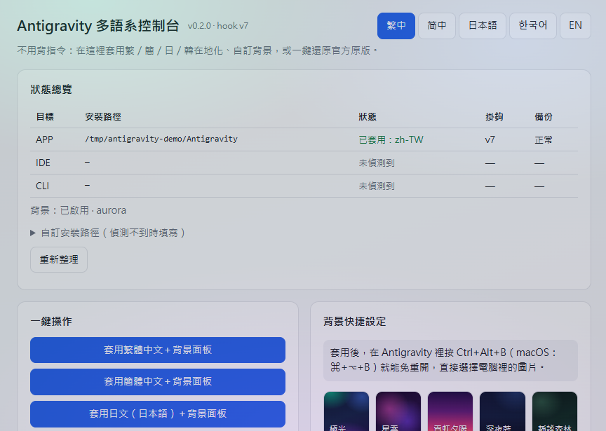
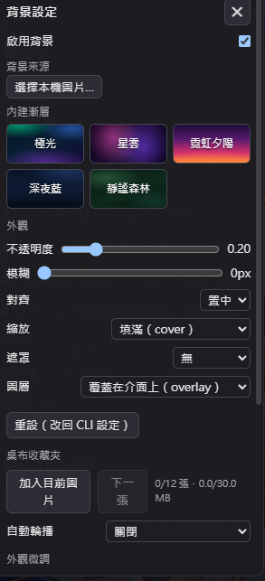
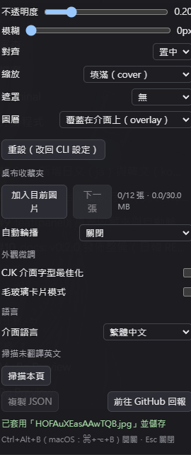
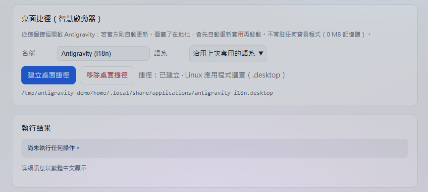

<p align="center"><a href="./README.md">繁體中文</a> | <b>简体中文</b> | <a href="./README.ja.md">日本語</a> | <a href="./README.ko.md">한국어</a> | <a href="./README.en.md">English</a></p>

# antigravity-i18n

[](https://github.com/Carinoasd/antigravity-i18n/actions/workflows/ci.yml)
[](./LICENSE)
[](https://nodejs.org/)

跨平台（Linux / macOS / Windows / WSL）的 **Google Antigravity 多语言本地化与外观工具**：支持繁体中文（`zh-TW`）、简体中文（`zh-CN`）、日语（`ja`）、韩语（`ko`）和自定义背景，**不用记命令**，打开图形控制台点一下就好。

## 📸 实机展示

> 实机截图整理中。维护者补图的文件名约定与隐私遮挡规范见 [docs/images/README.md](./docs/images/README.md)。

<!-- 实机展示截图：把图片放进 docs/images/ 后，删除这一行和表格下方的注释结束行即可显示
| 图形控制台 | 应用简体中文后的 Antigravity |
| :---: | :---: |
|  |  |
| **Ctrl + Alt + B 面板：背景、壁纸收藏夹与轮播** | **外观微调与五语即时切换** |
|  |  |
| **扫描本页未翻译的英文** | **桌面快捷方式（智能启动器）** |
|  |  |
-->

## 🚀 开始使用

### 方法一：下载单文件可执行程序，双击打开（推荐普通用户）

**无需安装 Node.js、无需输入命令。** 到 [Releases](https://github.com/Carinoasd/antigravity-i18n/releases/latest) 下载对应的文件：

| 系统 | 文件 |
| --- | --- |
| Windows（x64） | `antigravity-i18n-win-x64.exe` |
| macOS（Apple 芯片） | `antigravity-i18n-macos-arm64` |
| Linux（x64） | `antigravity-i18n-linux-x64` |

双击打开后，浏览器会自动打开本地图形控制台。

- **Windows**：出现“Windows 已保护你的电脑”（SmartScreen）时，点“**更多信息** → **仍要运行**”。可执行程序没有付费的代码签名证书，所以会出现这个提示。
- **macOS**：第一次请在访达中**右键 → 打开**，再点“打开”；如果仍被拦截，到“系统设置 → 隐私与安全性”点“**仍要打开**”。从浏览器下载的文件可能丢失执行权限，可先运行 `chmod +x antigravity-i18n-macos-arm64`。
- **Linux**：`chmod +x antigravity-i18n-linux-x64 && ./antigravity-i18n-linux-x64`
- 如果启动时出错，窗口会显示错误信息并等你按 Enter 才关闭，方便截图反馈。

**校验文件（建议）**：同一个 Release 附带 `SHA256SUMS.txt`，把它和可执行程序放在同一个文件夹：

```bash
# macOS
shasum -a 256 -c SHA256SUMS.txt --ignore-missing
# Linux
sha256sum -c SHA256SUMS.txt --ignore-missing
```

```powershell
# Windows（PowerShell）：比对输出的哈希与 SHA256SUMS.txt 中对应的那一行
Get-FileHash .\antigravity-i18n-win-x64.exe -Algorithm SHA256
```

> Release 会在维护者推送 `v*` tag 后自动构建。如果还没有 Release，请使用方法二。

### 方法二：用 npx 运行（开发者／已安装 Node.js）

需要 [Node.js 20 及以上](https://nodejs.org/)：

```bash
npx github:Carinoasd/antigravity-i18n
```

> ⚠️ npm 上名为 `antigravity-i18n` 的包**不是本项目**（属于另一位作者）。请使用上面的 `github:` 写法，或按下方步骤从源码安装。

### 控制台能做什么

- 一键应用“繁体中文 / 简体中文 / 日语 / 韩语 ＋ 背景面板”
- 只要自定义背景与 `Ctrl+Alt+B` 面板，保持英文界面
- 一键无损还原官方原版
- 应用 5 款内置渐变背景或选择电脑中的图片，调整不透明度／模糊／遮罩
- 创建桌面快捷方式：之后从快捷方式打开，官方自动更新覆盖本地化时会先自动重新应用
- 安装或移除 AI 全局语言规则（零侵入模式，四种语言均可）

> 控制台只监听 `127.0.0.1`，每次启动都会生成新的访问 Token，其他电脑或网站都无法操作。点“关闭控制台”或按 `Ctrl+C` 即可退出。

## ✨ 功能

- 🖥️ 支持 Antigravity **App**（桌面版 2.0+，`app.asar`）、**IDE**（编辑器与 Agent 面板）、**CLI**（`agy`）
- 🧩 App 采用**双层机制**：静态翻译主进程菜单／系统托盘／更新提示，加上**运行时 DOM 注入层**实时翻译动态加载的 React UI
- 🔒 应用前自动计算 SHA-256、备份原始文件并写入 Manifest，可**一键无损还原**
- 🧪 `--dry-run` 先预览命中字符串数与覆盖率，不改动任何文件
- 🎛️ **界面内面板**（`Ctrl + Alt + B`）：背景、壁纸收藏夹与轮播、外观微调、五语即时切换、未翻译扫描，全部无需重启
- 🚀 **智能启动器与桌面快捷方式**：不怕官方自动更新，且不常驻任何后台程序（0 MB 内存）
- 🪶 **零侵入模式**：只安装全局规则，让 AI 用指定语言回复，完全不修改安装文件
- 🎨 **仅背景模式**：`--lang none` 保持英文界面，只加上背景与面板
- ✅ 内置 CI 词库校验器（四种语言 key 一致性、占位符、保护词、繁简用语检查）

> ⚠️ 本项目为社区项目，与 Google 无关。修改应用程序文件有风险，请先用 `--dry-run` 预览，并确认 `restore` 可以正常使用。

## 🎛️ `Ctrl + Alt + B` 面板

在 Antigravity 中按 **`Ctrl + Alt + B`**（macOS：**`Cmd + Option + B`**）打开面板；在“设置 → 外观（Appearance）”页面右下角也会出现“🖼 背景设置”小按钮。所有改动立即生效。

> 面板本身也支持五种语言：会跟随 Antigravity 当前显示的语言自动切换（在下方的“界面语言”中切换时，面板也会同步切换）；仅背景模式下则按系统（浏览器）语言选择。

- **背景**：选择电脑中的 PNG / JPEG / WebP / GIF（上限 10 MB），或 5 款内置渐变，再调整不透明度、模糊、对齐、缩放、遮罩与图层模式。
- **壁纸收藏夹与自动轮播**：“加入当前图片”把背景存进收藏夹，点缩略图一键切换、点 ✕ 删除。为了控制内存，**单张 ≤ 10 MB、最多 12 张、总容量 ≤ 30 MB**，平时只在内存中保留当前这一张。轮播可选关闭／每次打开窗口换下一张／每 15、30、60 分钟，另有“下一张”按钮。
- **外观微调**（默认关闭）：
  - **CJK 界面字体优化**：普通界面改用 `PingFang TC`、`Microsoft JhengHei UI`、`Noto Sans CJK TC`、`Hiragino Sans`、`Malgun Gothic` 字体栈；代码、编辑器、终端与 mono 类的等宽字体不受影响。
  - **毛玻璃卡片模式**：对话框、菜单与卡片加上半透明背景与 `backdrop-filter: blur(10px)`。
- **界面语言即时切换**：繁體中文／简体中文／日本語／한국어／English（原文）。`apply` 会把四种语言的词库以共享 key 的精简格式一起打包，切换时直接重新翻译页面，无需刷新。原生菜单与系统托盘保持 `apply` 时的语言。
- **扫描本页未翻译的英文**：列出当前页面仍是英文、词库还没有收录的界面字符串（跳过代码、编辑器、终端、AI 回复与表单内容），可一键复制成 `{ "Original Text": "" }` 格式的 JSON，或直接到 GitHub 反馈。

面板的设置保存在 App 的 IndexedDB 中，优先于命令行的 `background.json`；按“重置”即可改回命令行设置。对应的命令：

```bash
antigravity-i18n bg presets                                    # aurora、nebula、sunset、midnight、forest
antigravity-i18n bg preset midnight --opacity 0.3 --tint "rgba(0,0,0,0.25)"
antigravity-i18n bg set ~/Pictures/wallpaper.jpg --opacity 0.2 --blur 4
```

背景层为 `pointer-events: none`，不会挡住点击。**WSL**：设置会同步镜像到 Windows 用户目录（`C:\Users\<你>\.antigravity-i18n`），让 Windows 版 Antigravity 读得到。

## 🔁 不怕自动更新：`launch` 与 `shortcut`

Antigravity 自动更新时会整个替换 `app.asar`，本地化就没了。`launch` 会在**你打开 Antigravity 的那一刻**检查一次，必要时自动重新应用，然后启动 Antigravity 并立即退出——**不常驻任何后台程序（0 MB 内存）**。

```bash
antigravity-i18n shortcut install                          # 在桌面创建指向 launch 的快捷方式
antigravity-i18n shortcut install --name "Antigravity 简体中文" --lang zh-CN
antigravity-i18n launch                                    # 也可以直接运行
```

| 情况 | `launch` 的动作 |
| --- | --- |
| `app.asar` 与上次修补后一致、挂钩为最新版 | 直接启动（以文件大小和修改时间缓存哈希，毫秒级跳过） |
| SHA-256 改变（官方刚更新）、挂钩为旧版，或 `--lang` 指定了不同语言 | 备份新版原始文件后重新应用，再启动 |
| Antigravity 已在运行、文件被锁定 | 显示提示、跳过本次重新应用，照常启动 |

| 平台 | 快捷方式 |
| --- | --- |
| Windows | 桌面 `.lnk`：Antigravity 图标，最小化运行（不会闪黑窗） |
| WSL | 检测到 Windows 端的 Antigravity 时，在 Windows 桌面创建 `.lnk`，通过 `wsl.exe -d <发行版> -- … launch` 运行 |
| macOS | `~/Desktop/<名称>.command` |
| Linux | `~/.local/share/applications/antigravity-i18n.desktop` |

图形控制台也有“桌面快捷方式”区块。通过 `npx` 运行时，快捷方式会指向 npx 的临时缓存，建议改用单文件可执行程序或全局安装。

## 🔒 安全备份与还原

- 写入前对每个原始文件计算 SHA-256、备份并回读校验，Manifest 会同时记录两个哈希。
- `--dry-run` 绝不写入任何文件，连工具的数据目录也不会创建。
- `restore` 校验备份后**逐字节**还原；如果文件在修补后又被修改（例如官方更新），默认中止，确定要还原请加 `--force`。
- 重新应用一律以原始文件为来源，不会在已翻译的内容上重复翻译；写入途中出错会自动回滚已写入的文件。

## 从源码安装

```bash
git clone https://github.com/Carinoasd/antigravity-i18n.git
cd antigravity-i18n
npm install        # 会自动构建
npm link           # 之后即可直接使用 antigravity-i18n 命令
antigravity-i18n   # 不带参数：打开图形控制台
```

不想 `npm link` 的话，也可以直接用 `node dist/cli.js <命令>` 运行。

## 命令行快速开始

```bash
antigravity-i18n status                          # 检测本机安装与当前状态
antigravity-i18n apply --lang zh-CN --dry-run    # 预览，不修改任何文件
antigravity-i18n apply --lang zh-CN              # 正式应用（请先退出 Antigravity）
antigravity-i18n apply --lang none --target app  # 只要背景与 Ctrl+Alt+B 面板，保持英文界面
antigravity-i18n restore                         # 还原官方原版
antigravity-i18n rules install --lang zh-CN      # 零侵入：只让 AI 用简体中文回复
```

## 命令一览

| 命令 | 说明 |
| --- | --- |
| `antigravity-i18n` / `ui [--port <n>] [--no-open]` | 打开本地图形控制台（只监听 `127.0.0.1`）。在 CI 或非交互环境中不带参数运行时，改为显示 `--help`。 |
| `status`（别名 `doctor`） | 检测到的 App / IDE / CLI 路径、本地化状态、挂钩版本、备份、背景与全局规则 |
| `apply --lang <zh-TW\|zh-CN\|ja\|ko\|none> [--target <app\|ide\|cli\|all>] [--path <目录>] [--dry-run] [--force] [--no-runtime]` | 备份并修补。已应用时默认拒绝重复覆盖，需加 `--force`（始终以原始备份重新翻译）。`none` 为仅背景模式，只适用于 `app`。 |
| `restore [--target ...] [--path <目录>] [--force]` | 校验备份 SHA-256 并逐字节还原 |
| `rules <install\|remove\|status> [--lang <zh-TW\|zh-CN\|ja\|ko>]` | 管理 `~/.gemini/config/rules/language-<语言>.md`（`trigger: always_on`） |
| `bg set <图片>` / `bg preset <名称>` / `bg presets` / `bg on\|off\|clear\|status` | 自定义背景（`--opacity`、`--blur`、`--size`、`--position`、`--mode overlay\|underlay`、`--tint`） |
| `launch [--lang <语言>] [--path <目录>] [--no-reapply]` | 智能启动器：官方自动更新后先重新应用，再启动 Antigravity 并立即退出 |
| `shortcut <install\|remove\|status> [--name <名称>] [--lang ...] [--path <目录>] [--dir <目录>] [--force]` | 创建／移除指向 `launch` 的桌面快捷方式 |
| `validate` | CI 用词库校验（exit code 0 / 1） |

升级本工具后，请通过 `launch`（或桌面快捷方式）打开一次 Antigravity，或运行 `antigravity-i18n apply --target app --lang <语言> --force`，以更新 App 挂钩（`status` 会提示）。

## 常见问题：`EBUSY` / `EPERM` / `EACCES`

表示 Antigravity 仍在运行（锁住了 `app.asar`），或安装位置需要管理员权限。命令行与控制台都会显示具体步骤：

1. 完全退出 Antigravity：关闭所有窗口，**并且**在系统托盘／菜单栏图标上右键 → Quit（退出）
2. Windows：在任务管理器中结束残留的 Antigravity 进程；安装在 `C:\Program Files` 时请以管理员身份打开终端
3. Linux / macOS 系统目录：使用 `sudo`，或用 `--path` 指向你有写入权限的安装位置
4. 重试一次——应用与还原都会先备份，重试是安全的

macOS 修改 App 内容会使代码签名失效，应用后请运行 `codesign --force --deep --sign - "/Applications/Antigravity.app"` 重新签名。

## 🤝 贡献词库

1. **最快的方式**：在 Antigravity 中按 `Ctrl + Alt + B` → 扫描本页 → 复制 JSON，再点“到 GitHub 反馈”，把 JSON 粘贴到[缺少翻译的 Issue 模板](https://github.com/Carinoasd/antigravity-i18n/issues/new?template=missing-translation.yml)。
2. **直接提 PR**：修改 `locales/<语言>/<模块>.json`，**四种语言同时加上相同的 key**（key 必须与界面上的英文完全一致），运行 `node dist/cli.js validate` 确认 0 错误后提交。
3. 用语规范（例如 zh-CN 用“设置”“默认”“文件夹”）与 PR 检查清单见 [CONTRIBUTING.md](./CONTRIBUTING.md)。

## 更多文档

- [繁体中文 README](./README.md) 包含最完整的说明（检测路径、替换规则、运行时注入层原理、数据目录结构）。
- 版本变更见 [CHANGELOG.md](./CHANGELOG.md)；AI 编程助手的协作规范见 [AGENTS.md](./AGENTS.md)。

## 许可证

[MIT](./LICENSE)
